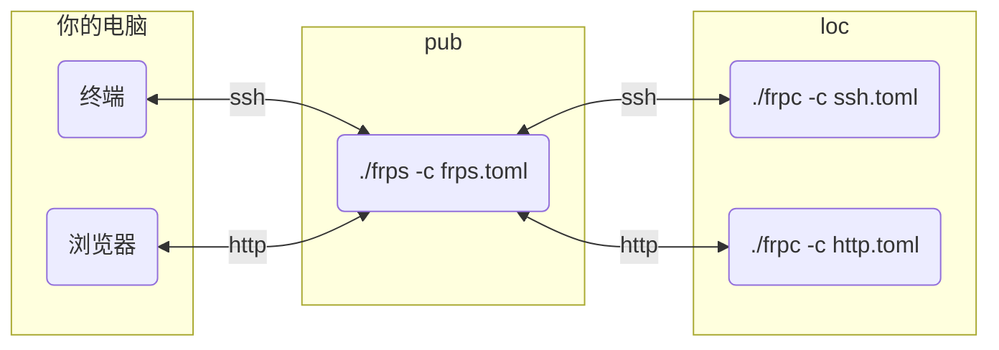

<center>
<iframe frameborder="no" border="0" marginwidth="0" marginheight="0" width=330 height=86 src="//music.163.com/outchain/player?type=2&id=454224831&auto=1&height=66"></iframe>
</center>

## 前言

相信不少的研究生/博士生同学都遇到过一个很麻烦的事情——实验室用的服务器只有连上实验室的内网后才能使用，一旦外出开 party 或者回家后，就不能进入实验室的服务器继续玩耍（卷）了。这个时候怎么办呢？

> 相信不少实验室都已经安装了堡垒机或者跳板机用于解决这个问题，本文提供没有此项服务的实验室倒霉蛋慢慢折腾。

不过嘛，我写这篇文章倒不是因为我遇到了这个问题，而是别的需求。但是请放心，我在解决我的问题时，会顺带解决这个许多读者都关心的问题。至于后面的我自己的问题的解决，看你自己的需求喽。

最近因为一些工作上的需求，我需要在浏览器上访问一个只有在某个实验室局域网内才能访问的 https 服务（别问我为啥内网还搞 https，我 tnnd 也不知道）。

那么，为了完成这样一个需求，我们需要实现两件事：

1. 我们可以在公网上使用 ssh 访问某台内网服务器，这样才方便进行后续操作。
2. 我们可以通过公网访问到内网的某个 http/https 服务，这样，我们后续只需要在那台内网服务器上编写一个简单的代理程序就能访问任何一个内网 https 服务了。

---


## 原料

### 硬件

为了达到这个目的，在硬件上，我们的读者需要准备如下三件东西：

1. 一台公网服务器，它的 IP 可以在任何能上网的机器上被 ping 到。
2. 一台实验室服务器，它只能在实验室内网被访问。
3. 一台你自己的电脑，它能 ping 到公网服务器，但是当你带着它出去玩时，它无法 ping 到实验室服务器。

很幸运的是，我们只需要通过一个命令行软件就能实现这两个需求！既然是命令行软件，大家估计也能猜到了，肯定是 go 或者 rust 写的。我知道连小型 C++ 项目都不会编译的读者们肯定也懒得去研究如何编译 go 或者 rust，不过这次这个软件好心的作者已经帮我们编译好了。

这次使用的软件就是内网穿透界鼎鼎有名的 frp：[fatedier/frp: A fast reverse proxy to help you expose a local server behind a NAT or firewall to the internet.](https://github.com/fatedier/frp)

### 软件知识

为了顺利执行完成本文的内容，你需要会：

- 基础 linux 操作
- 基础网络应用层的知识（http，ssh，https 等）
- 能基于 nodejs 编写简易代理服务器（教程在这儿 [linux screen / tmux 使用方法](https://kirigaya.cn/blog/article?seq=105)）
- （可选）能在linux服务器后台运行程序（教程在这儿  [nodejs 编写简易代理服务器](https://kirigaya.cn/blog/article?seq=191)）
- （可选）一个正常的大脑

---

## 软件安装

我们记我们的公网服务器为 pub (public server)，实验室服务器为 loc (local server)。我们在 `pub` 和 `loc` 上同时下载对应操作系统和芯片指令集的编译版本：https://github.com/fatedier/frp/releases

不过考虑到大部分的服务器都是 x86 芯片的 linux，所以可以直接下载解压如下：

```bash
wget -c https://github.com/fatedier/frp/releases/download/v0.55.1/frp_0.55.1_linux_amd64.tar.gz
tar -xvf frp_0.55.1_linux_amd64.tar.gz
```

进入 `frp_0.55.1_linux_amd64` 后，我们会看到如下几个文件：

- `frpc`： frp 客户端执行程序
- `frpc.toml`：frp 客户端配置文件
- `frps`：frp 服务端执行程序
- `frps.toml`：frp 服务端配置文件
- `LICENSE`：frp 软件开源协议，不用管

对于我们这个例子来说， `pub` 用于转发网络请求实现内网穿透，所以它是服务端，使用 `frps`。`loc` 是被转发的对象，所以是客户端，使用 `frpc`. 本文所有技术的整体访问模型如下：

<center>


</center>

---

## 第一步 SSH 内网穿透

为了让我们可以在外部能够访问 loc，我们先来实现 SSH 协议的内网穿透。首先我的读者需要知道如何在后台运行程序，因为我们在 pub 和 loc 上开启的服务都需要常驻内存，开后台的简易教程： [linux screen / tmux 使用方法](https://kirigaya.cn/blog/article?seq=105)。不过这个教程写得非常简单，更加详细的教程大家可以去搜搜 screen 和 tmux 这两个工具，只需要挑选一个即可，我推荐 screen。

首先在 `pub` 上，进入解压后的 frp 文件夹。修改 `frps.toml` 如下：

```toml
bindPort = 7000
```

bindPort 用于和 frpc 进行绑定。

在后台执行如下指令：

```bash
./frps -c ./frps.toml
```

输出如下日志，代表 frps 启动成功：

```
2024-03-20 22:56:58.972 [I] [frps/root.go:105] frps uses config file: ./frps.toml
2024-03-20 22:56:59.041 [I] [server/service.go:225] frps tcp listen on 0.0.0.0:7000
2024-03-20 22:56:59.041 [I] [server/service.go:292] http service listen on 0.0.0.0:8080
2024-03-20 22:56:59.041 [I] [frps/root.go:114] frps started successfully
2024-03-20 22:57:12.775 [I] [server/service.go:563] [11abba605bc7fe77] client login info: ip [58.211.218.74:64089] version [0.55.1] hostname [] os [linux] arch [amd64]
2024-03-20 22:57:12.806 [I] [proxy/tcp.go:82] [11abba605bc7fe77] [ssh] tcp proxy listen port [7001]
2024-03-20 22:57:12.806 [I] [server/control.go:401] [11abba605bc7fe77] new proxy [ssh] type [tcp] success
```


找一个还在实验室的朋友，然后让 TA 进入 `loc` 中，创建 `ssh.toml` 如下：

```toml
serverAddr = "x.x.x.x"
serverPort = 7000

[[proxies]]
name = "ssh"
type = "tcp"
localIP = "127.0.0.1"
localPort = 22
remotePort = 7001
```

- 其中 serverAddr 是 `pub` 的公网 IP，serverPort 和 刚刚 `pub` 上的 bindPort 保持一致。
- 请保证 localPort 是 `loc` 上的 ssh 服务端端口号，此处填写 22 是因为 sshd 默认开放的端口就是 22。
- remotePort 是我们后面访问 `pub` 时需要使用的转发端口。

然后，在后台启动 frpc ：

```bash
./frpc -c ./ssh.toml
```

输出如下日志代表 frpc 启动成功：

```
2024-03-20 21:17:55.986 [I] [sub/root.go:142] start frpc service for config file [./ssh.toml]
2024-03-20 21:17:55.986 [I] [client/service.go:287] try to connect to server...
2024-03-20 21:17:56.087 [I] [client/service.go:279] [11abba605bc7fe77] login to server success, get run id [11abba605bc7fe77]
2024-03-20 21:17:56.087 [I] [proxy/proxy_manager.go:173] [11abba605bc7fe77] proxy added: [ssh]
2024-03-20 21:17:56.120 [I] [client/control.go:170] [11abba605bc7fe77] [ssh] start proxy success
```

在你的 `pub` 防火墙中，放行如下两个端口：bindPort，remotePort。在我的例子中，是 7000 和 7001 这两个端口。

最后，打开你的电脑，输入：

```bash
ssh loc的用户名@pub的公网IP -p 7001
```

效果如下：

<div align=center>

</div>

成功进来啦！

---

## 第二步 HTTP 内网穿透

接下来的一步就更加有趣了，我们要转发 http，这一步的原理和我们平时使用的 VPN 其实差不多了，就是做带规则的 http/https 转发。我们首先在 `pub` 指定一下我们访问入口的端口：

```toml
bindPort = 7000
vhostHTTPPort = 7002
```

这样，我们后面就可以通过 `https://<pub公网IP绑定的域名>:7002` 来访问了。

> 因为 nginx 的原因，我无法测试 `https://<pub公网IP>:7002` 能否访问，留给读者明鉴了

然后重新启动 frps，并在防火墙放行 vhostHTTPPort 这个端口。

回到 `loc` 这边，创建 `http.toml`：

```toml
serverAddr = "x.x.x.x"
serverPort = 7000

[[proxies]]
name = "web"
type = "http"
localPort = 8001
customDomains = ["kirigaya.cn"]
```

:::info

如果你没有域名，直接把 customDomains 填 serverAddr 里面填入的 IP 也行！

:::

- localPort 要指向一个有效的本地的 http 服务的端口，8001 是我的一个本地服务，所以我填了 8001.
- customDomains 需要填写一个可被你自己的浏览器解析的域名，此处我填写了我自己的服务器公网IP绑定的域名。你也可以通过改变本地的 DNS 服务器的解析结果来解决没有域名的问题

然后在后台运行新的 frpc（之前那个 ssh 的 frpc 别干掉了）：

```bash
./frpc -c ./http.toml
```

输出如下信息代表代理成功：

```
2024-03-21 01:30:41.909 [I] [sub/root.go:142] start frpc service for config file [./http.toml]
2024-03-21 01:30:41.910 [I] [client/service.go:287] try to connect to server...
2024-03-21 01:30:41.999 [I] [client/service.go:279] [60aa3b96184ab33b] login to server success, get run id [60aa3b96184ab33b]
2024-03-21 01:30:41.999 [I] [proxy/proxy_manager.go:173] [60aa3b96184ab33b] proxy added: [web]
2024-03-21 01:30:42.028 [I] [client/control.go:170] [60aa3b96184ab33b] [web] start proxy success
```

在你的电脑上打开浏览器，输入如下 url 进行访问：

```
http://<customDomains[0]>:<vhostHTTPPort>
```

效果如下：

<div align=center>

</div>

但是对我来说，这么做还不够，因为我要访问的，并不是 `loc` 这个服务器上的 http 服务，而是一个和 `loc` 处于同一个局域网内的另外一个服务器的 https 服务，而且这个 https 服务的 SSL 证书还过期了。对于如此具体的要求，我们必须要编写代理服务器，不过也很简单，只需要在编写完成后，将 localPort 改成代理服务器暴露的端口即可。具体可以参考我之前的文章：https://kirigaya.cn/blog/article?seq=191

---

## 更加标准的 frp 配置文件

让我们更进一步吧！上面的步骤虽然解决了我们的问题，但是如果你的服务器上有一堆的端口需要转发，上面的配置显然是无法满足的，而且每次增加一个转发就要添加一个新的 frpc，太麻烦了！

我们可以通过更加通用的 `type = "tcp"` 来完成更加通用的配置。tcp 支持 http，ssh，websocket 等等应用层协议的转发。

假设我们现在需要把内网的 8080 映射到公网的 7002（http 服务），8282 到 8282（ws 服务），还需要暴露 ssh 到公网的 7001.可以这么写 frp 客户端：

```bash
serverAddr = "101.43.239.71"
serverPort = 7000

auth.method = "token"
auth.token = "12345678"

# ssh
[[proxies]]
name = "ssh"
type = "tcp"
localIP = "127.0.0.1"
localPort = 22
remotePort = 7001

# filebrowser
[[proxies]]
name = "filebrowser"
type = "tcp"
localPort = 8080
remotePort = 7002


# openmcp backend
[[proxies]]
name = "openmcp"
type = "tcp"
localPort = 8282
remotePort = 8282
```

注意，此处我们加入了 token，在真实的部署中，这是必须加的，因为 frp 是开源的，它的默认密码是 12345678，很容易遭到攻击！

服务端 frp 这么写：

```bash
bindPort = 7000

auth.method = "token"
auth.token = "12345678"
```

此处我们取消了vhostHTTPPort，因为我们不再需要它模拟了，直接 tcp 就能解决问题。如上，我们就能轻松安全地批量转发内网的服务了！

玩得开心！