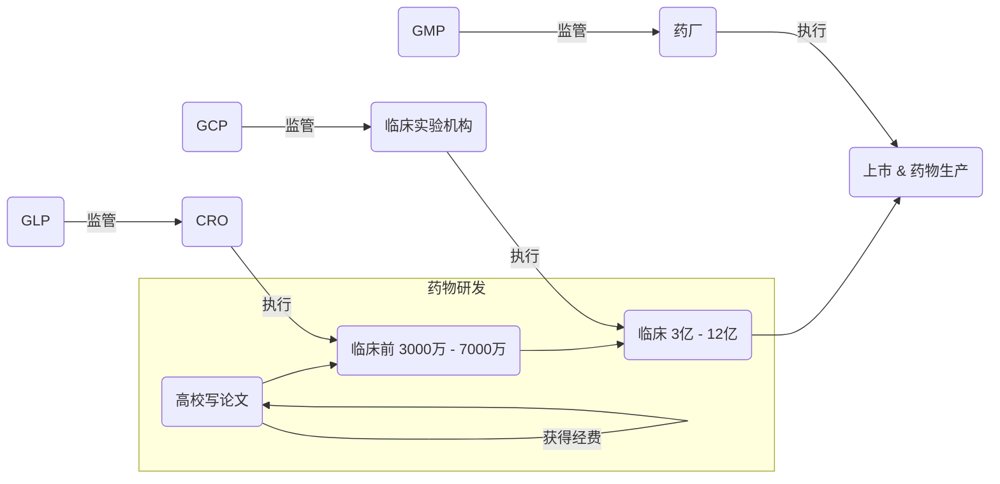

## FDA & CFDA

FDA(Food and Drug Administration) 是美国用于监管食物和药物的部门。在我国，CFDA(China Food and Drug Administration) 是对应的机关，下辖的 CDE(Center for Drug Evalutaion) 是直接对药物进行审批的部分。

在国内，药物是否可以上市，医药实验室的结果是否合格被认可，都是由 CDE 直接决定。

## 药物的研发流程

药物的基本研发流程如下：

- 高校阶段：高校的主要工作在于进行基础研究，但是大部分的高校研究更多的目的在于进行教育，而非产生具有实际意义的成果。

- 临床前阶段：当一个药物打算进行生产后，就需要先进行临床前的实验，这个阶段需要让具有实验资质的**专业实验室和接受过专业培训的研究人员**进行操作并记录各项实验结果。绝大部分高校实验室并不具有这种资质，因此，这一部的实验结果往往外包给有 GLP 资质的专业研究所或者公司完成。他们的雇佣费用和物料费构成了“临床前”的主要成分。

- 临床阶段：临床的进行需要通过具有 GCP 资质的机构代行。临床主要的成本在于受试者。新冠期间，各国研发的新冠药物中，临床投入成本巨大。在南美洲部分国家，邀请一个受试者进行实验需要大概 8 万元/人次，国内会选择偏远山区，成本为 2 万元/人次。监管临床阶段的职能机关被称为 GCP。

- 生产阶段：当通过上述的步骤后，药物就可以上市了。这个步骤通过具有 GMP 资质的药厂执行，并通过后续的销售团队进行销售。

### 一些历史遗留问题

如上所言，专业实验室、临床执行机构、药厂都直接受 CDE 的监管。

东北曾经最大的药厂就因为为了降低成本混淆了不同生产日期的疫苗而被吊销 GMP 执照，最终导致公司倒闭。

CFDA 在改开后曾随意给药企颁布过大量的资格执照，导致本世纪初国内制药企业乱想丛生，但是客观上也降低了药物的销售价格。近10年来，国内逐步建立起了完备的医药审查与上市的制度和流程。

受限于历史原因，已经上市的仿制药物**不需要重新补做完整的临床实验**，因为这么做成本过于高昂，强制执行会让大量药企倒闭，**从而客观导致药物价格上升，危及民生**。

CFDA 对于社会的影响深远，CFDA 曾经的某局长因为随意发布执照且收受贿赂，被枪决。虽然 TA 当年收的贿赂并没有超出7位数。

### 新冠期间疫苗盈利的公司

新冠期间，新冠疫苗国内盈利的公司只有三家。

- 中国医药集团有限公司，简称国药
- 智飞龙科马
- 科兴