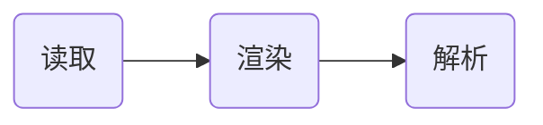

## TODO

找到所有 vcd item 的 type 类型，可参考：https://pyvcd.readthedocs.io/en/latest/vcd.common.html

### bug

详见飞书文档：https://nc-ai-lab.feishu.cn/wiki/Z4AxwU1SdilATAk7GuvcYkIDnwh

---

## 流程

目前需要为Digital-IDE设计一个render用于显示VCD文件。

> IEEE 1364定义VCD(value change dump)文件是含已选变量（信号）的值变化信息存储文件。 

wavedrom在GitHub上开发过vcd和hdl的wavedrom脚本格式，可以用于进行DIDE的vcd可视化的二次开发，目前发现，为了实现vcd文件，基本的仓库主要是下面这两个：

- JS层与一个简单的前端：https://github.com/wavedrom/vcdrom

- wasm 解析：https://github.com/wavedrom/vcd

打算基于这两个仓库二次开发一个好用的vcd渲染模块，再加入DIDE中。

---

## 开发思路

vcd 的渲染器分为如下几步进行开发。



VCD 读取和解析并不难，难在如何快速安全地读取，对于一些长时间的模拟和仿真而言， vcd 文件可能会非常大。因此，vcd 需要分块读取，分块解析，为了避免这些不必要的麻烦，我使用了 https://github.com/wavedrom/vcdrom 这个项目的后端进行修改。

<br>

### wasm 解析器

原项目写得过于紧凑，并不适合进行修改，因此需要修改一部分代码。

整合项目在 ： https://github.com/Digital-EDA/digital-vcd-parser

看着 README 一步步做就行，记得是在 linux 环境下。

### 基本使用

为了高效IO，接口层使用需要基于 stream，演示如下：
```javascript
(async () => {
    // 用fetch，或者读取 vscode 的 message 事件获取 IO stream 都行
    const readStream = await readVcdFile();
    const vcdstream = await window.getVcdStream();

    const values = {};

    vcdstream.change.any((id, time, cmd, value, mask) => {
        if (values[id] === undefined) {
            values[id] = [];
        }
        values[id].push({time, cmd, value, mask});
    })

    readStream.on('data', data => {
        const value = new Uint8Array(data);
        vcdstream.write(value);
    });

    readStream.on('end', () => {        
        const body = vcdstream.info.wires.body[1].body;
        const cpu = body[body.length - 2];
        const register = cpu.body[cpu.body.length - 4];
        console.log(register.body);
        console.log(values['D']);
    });
})()
```

其中 `end` 事件的回调函数中存着所有的信号和它们树形的依赖关系。每一个信号都有一个名为 `link` 的属性，这个属性是信号的映射代号。

values 对象中存储着所有的信号的 diagram， 索引值是 信号的 link 而不是 name，需要进行转换。值为一个对象 `{ time: 0n, cmd: 30, value: 0n, mask: 1n }`：
- time：当前信号电平的起始时间，也是上一个信号电平的终止时间。
- cmd：如果值在 14 到 28 之间，则代表当前的信号电平；否则，无意义。
- value：如果 cmd 在 14 到 28 之间，则为 undefined；否则，代表当前电平大小。
- mask：如果 cmd 在 14 到 28 之间，则为 undefined；否则，如果为 1n 代表当前电平信号为高阻态， 0n 代表正常。

## 转换

原生的 vcdrom 是在 nodejs 环境下开发的，为了将它转换成浏览器环境下的，需要进行转换，具体看：https://github.com/wavedrom/vcdrom

```bash
git clone https://github.com/wavedrom/vcdrom
cd vcdrom
npm i
mkdir app
npm run build
```

根据需要导出文件的需求，修改 `./lib/vcdrom.js` ，这个打包后的入口文件。