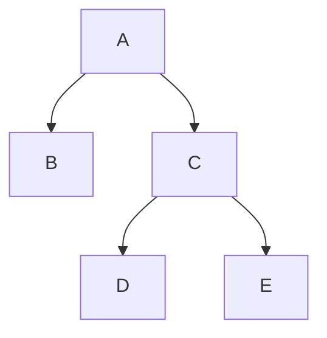
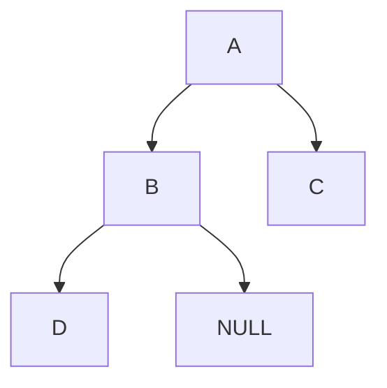
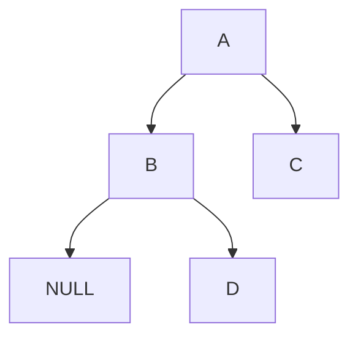
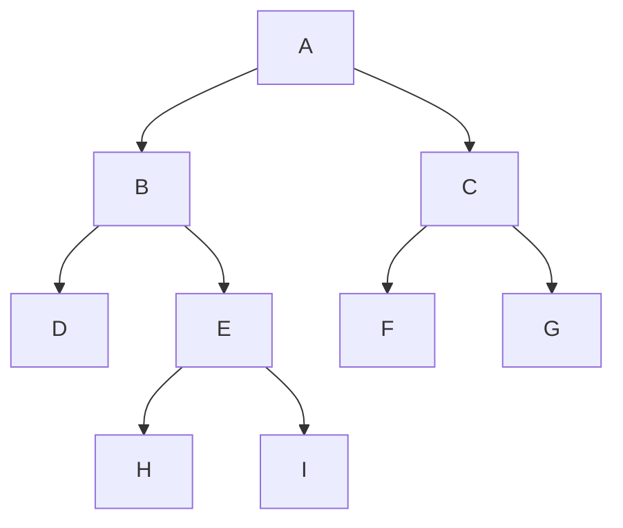

好几年前的文章了，从 CSDN 上搬运过来的。

## 前言
二叉树可以说是树形数据结构中最基础的，且在多种领域都有应用（比如语法树，二值决策树），熟悉其各种操作是必须的。本文通过实现几个基本的函数来实现一个基本的二叉树：
```cpp
#include <iostream>
#include <cstring>
#define N 100
using namespace std;

typedef struct node
{
	char data;
	struct node *left, *right;
}BT;

BT *createbt(char *in, char *pre, int k);	// 根据输入二点中序表达式和前序表达式创建一颗二叉树
void showBt(BT *T);		// 展示一颗二叉树，以A(B, C(D, E))这样加了括号的前序遍历来实现
void *destroy(BT *T);	// 销毁二叉树
bool iscomplete(BT *T);	// 判断这颗树是不是完全二叉树
int height(BT *T);		// 计算树的高度
int leaf(BT *T);	// 计算叶子的数量
int width(BT *T);		// 计算树的宽度
void layer(BT *T);		// 层次遍历
void preorder(BT *T);	// 前序遍历
void inorder(BT *T);	// 中序遍历
void postorder(BT *T);	// 后序遍历	
void getPath(BT *T, BT **path, int top)		// 输出根节点到所有叶子节点的路径(递归)
void getPath(BT *T);	// 输出根节点到所有叶子节点的路径(非递归)
BT *lca(BT *T, char a, char b);		// 返回节点数据为a和b的两个节点的最近公共祖先
```
其中，我们的二叉树的是以链式结构建立的，链式结构的每个节点都用`BT`结构体表示，这个结构体的`data`代表树的该节点存储的数据（此处为了方便使用`char`作为存储数据，实际使用时，可以使用各种各样的数据类型代表这个`data`，甚至在`BT`下挂载多个数据也是没问题的）。`*left`和`*right`分别代表指向该节点的左节点和右节点的指针。

---

## 创建二叉树
为了方便，此处使用前序遍历和中序遍历的表达式递归地创建一颗二叉树。
```cpp
BT *createbt(char *in, char *pre, int k)
{
	if (k <= 0)
		return NULL;
	else
	{
		BT *node = new BT;
		node->data = pre[0];	// 前序表达地第一个元素就是这颗子树地根节点
		int i;
		for (i = 0; in[i] != pre[0]; ++ i);		// 根据一个计数器i获取中序表达式中node->data的位置
		node->left = createbt(in, pre + 1, i);
		node->right = createbt(in + i + 1, pre + i + 1, k - i - 1);
		return node;
	}
}
```
---

## 展示二叉树
展示一棵二叉树。它的顺序和前序遍历是一样的，只是我们给他们加上括号。比如我们的二叉树如下图：


很显然，它的前序表达式为ABCDE，那么我们的展示函数就在前序表达式的基础上加上括号来代表其层次关系：A(B,C(D,E))。

```cpp
void showBt(BT *T)
{
	if (T)
	{
		cout << T->data << " ";
		if (T->left || T->right)	// 判断一下当前递归到的节点有没有字节点，如果没有子节点，我们就不需要打上括号了
		{
			cout << "(";
			showBt(T->left);
			cout << ",";
			showBt(T->right);
			cout << ")";
		}
	}
}

```
---

## 销毁二叉树
递归地销毁一棵二叉树，比较简单，不做赘述。注意一下带哦用递归和销毁当前节点的顺序。
```cpp
void *destroy(BT *T)
{
	if (T)
	{
		destroy(T->left);
		destroy(T->right);
		delete T;
	}
}
```
---

## 判断是否为完全二叉树
如果一棵树是满叉的二叉树，那么它肯定是完全二叉树，如果一棵树不是满叉的二叉树，那么不满叉的那一层的所有节点都要靠左。比如如下的不满叉的二叉树是完全二叉树：

而下面的这颗不满叉的二叉树则不是完全二叉树：

因为D这个节点没有靠到最左边。由是，我们可以得到一个简单的判断逻辑。

如果根节点为NULL，则不是完全二叉树，直接返回`false`。否则，我们通过层次遍历来遍历整颗树，通过一个变量`flag`来判断是否已经到达过了叶子节点或者只有左子节点的节点（默认为`false`，表示没有到达过），因为我们只有遍历到了这两类节点的话，那么后续所有的节点都必须为叶子节点，在遍历的过程中做如下的判断：

1. 如果当前节点没有左子节点，但有右子节点，返回`false`。
2. 如果当前节点是叶子节点，则`flag=true`。
3. 如果当前节点只有左子节点，判断`flag`是否为`true`，若是，则返回`false`，否则`flag=true`。
4. 如果当前节点既有左子节点又有右子节点，则判断`flag`是否为`true`，若是，则返回`false`。

整个树遍历完后，返回`true`。

```cpp
bool iscomplete(BT *T)
{
	if (!T)
		return false;
		
	BT *q[N], *p;
	int front, rear;
	front = rear = 0;
	q[rear ++] = T;
	bool flag = false;
	
	while (front != rear)
	{
		p = q[front ++];
		
		if (!p->left && !p->right)
			flag = true;
		else if (!p->left && p->right)
			return false;
		else if (p->left && !p->right)
		{
			if (flag)
				return false;
			else
				flag = true;
		}
		else
		{
			if (flag)
				return false;
		}
		
		if (p->left)
			q[rear ++] = p->left;
		if (p->right)
			q[rear ++] = p->right;	
	}
	return true;
}

```
---

## 计算树的高度
树的高度可以认为是层数，也就是根节点到叶子节点中路径最长的那条路径包含的节点数量。此后通过递归实现：
```cpp
int height(BT *T)
{
	if (!T)
		return 0;
	else
		return max(height(T->left) + 1, height(T->right) + 1);
}
```

---

## 计算树的叶子数量
思路和计算树的高度差不多，不过需要额外判断一下叶子节点的情况：
```cpp
int leaf(BT *T)
{
	if (!T)		
		return 0;
	else if (!T->left && !T->right)	// 当前节点为叶子，那么叶子的数量当然是1
		return 1;
	else
		return leaf(T->left) + leaf(T->right);
}
```
---

## 计算树的宽度
树的宽度定义为含有节点为最多节点的那一层所含有的节点数，比如下面这幅图：

上面这幅图中DEFG这层有的节点数量最多，为4个，因此这颗二叉树的宽度为4。

很明显，我们是通过比较层的节点数量来确定宽度，因此我们需要通过层次遍历来获取宽度。不过不同于一般的层次遍历的写法，我们需要统计完一层的节点树，然后直接把这一层的节点全部弹出，然后把它们的子节点入队。

我们记答案为`max_wid`，每层的节点数为`count`，很明显`count = rear - front`，那么我们通过`count`这个值做`count`次出队，入队操作就可以把第`n`层的节点全部弹出，把`n+1`层的节点全部入队。

```cpp
int width(BT *T)
{
	BT *q[N], *p;
	int front, rear;
	front = rear = 0;
	q[rear ++] = T;
	
	int max_wid = 0;
	
	while (front != rear)
	{
		int count = rear - front;	// 通过队列的front和rear直接得出当前层的节点数量
		max_wid = max(max_wid, count);	// 更新当前的最大宽度
		
		while (count --)	// 根据count将当前层的所有节点弹出，把它们的子节点入队，完成层次遍历的队列更新
		{
			p = q[front ++];
			if (p->left)
				q[rear ++] = p->left;
			if (p->right)
				q[rear ++] = p->right;
		}
	}
	return max_wid;
}
```
---

## 层次遍历
层次遍历通过队列是实现，每出队一个元素，就将它的左子节点和右子节点入队（如果有的话）。
```cpp
void layer(BT *T)
{
	BT *q[N], *p;
	int front, rear;
	front = rear = 0;
	q[rear ++] = T;
	
	while (front != rear)
	{
		p = q[front ++];	// 队首元素出队
		cout << p->data << " ";
		
		// 将出队的元素的子节点入队
		if (p->left)
			q[rear ++] = p->left;
		if (p->right)
			q[rear ++] = p->right;
	}
}
```

---


## 前序遍历
### 递归写法
前序的递归写法非常直观，不多说：
```cpp
void preorder(BT *T)	// 前序遍历 
{
	if (T)
	{
		cout << T->data << " ";
		preorder(T->left);
		preorder(T->right);
	}
}
```

### 非递归写法
前序遍历的非递归通过栈来实现，要先输出的元素后入栈，要后输出的元素先入栈：
```cpp
void preorder(BT *T)
{
	BT *s[N], *p;
	int top = 0;
	s[top] = T;
	
	while (top >= 0)
	{
		// 首元素的栈筛比较简单，就是直接输出就完事儿
		p = s[top --];
		cout << p->data << " ";
		
		// 后续要递归的栈筛入栈
		if (p->right)
			s[++ top] = p->right;
		if (p->left)
			s[++ top] = p->left;
		
	}
}
```
---

## 中序遍历
### 递归写法
```cpp
void inorder(BT *T)	// 中序遍历 
{
	if (T)
	{
		preorder(T->left);
		cout << T->data << " ";
		preorder(T->right);
	}
}
```
### 非递归写法
中序遍历的非递归还是通过栈来实现的，只不过与前序遍历相比，我们的根节点不能直接输出，所以我们需要额外的栈筛来保存中间输出的各个子树的根节点，这个节点为`p`：

```cpp
void inorder(BT *T)
{
	BT *s[N], *p = T;
	int top = -1;
	
	while (top >=0 || p)
	{
		while (p)	// 由于中序遍历需要将所有的左子树输出，所以首先将左子树的栈筛入栈
		{
			s[++ top] = p;
			p = p->left;
		}
		
		p = s[top --];
		cout << p->data << " ";
		p = p->right;	// 如果该节点有右节点，则根据中序遍历的规则进入右子树（该节点被当作局部子树的根节点）；如果没有右节点，根据代码结构，打印上一层的节点（该节点被当作局部子树的左节点）
	}
}
```
---

## 后序遍历
### 递归写法
```cpp
void postorder(BT *T)	// 后序遍历 
{
	if (T)
	{
		preorder(T->left);
		preorder(T->right);
		cout << T->data << " ";
	}
}
```
### 非递归写法
后续遍历的非递归写法也是通过栈来实现的，因为此时的各个子树的根节点是在最后才输出的，所以我们需要保存左子树的栈筛和右子树的栈筛。我们还需要一个临时变量来指明当前遍历到的节点的右子节点是否被访问过。

```cpp
void postorder(BT *T)
{
	BT *s[N], *p = T, *last;	// last变量用来判断当前访问的节点的右子节点是否被访问过
	int top = -1;
	
	do
	{
		while (p)	// 左子树的栈筛全部
		{
			s[++ top] = p;
			p = p->left;
		}
		last = NULL;
		while (top >= 0)	// 遍历打印没有右节点的根节点，或者访问没有访问过的右子树
		{
			p = s[top];
			if (p->right == last)
			{
				top --;
				cout << p->data << " ";
				last = p;
			}
			else
			{
				p = p->right;
				break;
			}
		}	
	}while (top >= 0);
}
```
---

## 输出根节点到所有叶子节点的路径(递归)
递归写法没什么好说的=_=，还是很简单的。注意在主函数中调用该函数时，需要额外传入一个存储参数的path数组，起始填入的top为-1。
```cpp
void getPath(BT *T, BT **path, int top)
{	
	if (!T)
		return;
	else if (!T->left && !T->right)
	{
		for (int i = 0; i <= top; ++ i)
			cout << path[i]->data << " ";
		cout << T->data << endl;
	}
	else
	{
		path[++ top] = T;
		getPath(T->left, path, top);
		getPath(T->right, path, top);
	}
} 
```
---

# 输出根节点到所有叶子节点的路径(非递归)
此处一定记住，只要是涉及到输出路径输出，一定是有限考虑后序遍历，因为后序遍历是左子树->右子树->根节点的顺序，这就使得使用后序遍历访问到一个元素时，栈中剩余元素恰为根节点到该元素的路径，所以我们只要将后序遍历中的`cout`改成一个判断：若当前元素是叶子，则将栈中元素依次输出。

```cpp
void getPath(BT *T)
{
	BT *s[N], *p = T, *last;
	int top = -1;
	
	do
	{
		while (p)
		{
			s[++ top] = p;
			p = p->left;
		}
		last = NULL;
		while (top >= 0)
		{
			p = s[top];
			if (p->right == last)
			{
				top --;
				if (!p->left && !p->right)	// 判断当前访问的节点是否为叶子节点，若是，则输出栈内元素
				{
					for (int i = 0; i <= top; ++ i)
						cout << s[i]->data << " ";
					cout << p->data << endl;
				}
				last = p;
			}
			else
			{
				p = p->right;
				break;
			}
		}
	}while(top >= 0);
}
```


---

## 计算二叉树的公共祖先(lca)
### 递归写法
计算lca的递归写法比较简单，首先判断当前的根节点是否为空，若为空，直接返回NULL；若要寻找lca的两个节点其中一个就是当前的根节点，说明其中一个节点就是另一个节点的祖先，则返回当前的根节点；接下来进入递归，往根节点的左节点和右节点去递归，得到**以根节点的左节点为根节点的lca节点left**和以**以根节点的右节点为根节点的lca节点right**。

如果left和right都是空，说明递归的两个分支都没有答案，那么就是没有答案，返回NULL；如果left和right都不为空，说明两边递归下去都有结果，说明我们要寻找lca的两个节点分散在根节点的左右分支上，所以当前的根节点就是lca；如果left和right中一个为空，一个不为空，则说明两个节点都集中在其中的一个分支上，返回那个非空节点，它就是lca。
```cpp
BT* lca(BT *T, char a, char b)
{
	if (!T)
		return NULL;
	if (T->data == a || T->data == b)
		return T;
	
	BT *l = lca(T->left, a, b);
	BT *r = lca(T->right, a, b);
	
	if (!l && !r)
		return NULL;
	else if (l && r)
		return T;
	else if (!l && r)
		return r;
	else if (l && !r);
		return l;
}
```
 
### 非递归写法
lca的非递归写法可以使用一个暴力的做法来实现，比如我们现在寻找下面这棵树中D和H的lca节点。


我们可以先找到根节点A到D和H的路径，它们的路径分别ABD和ABEH，然后我们来同时从这两条路径的开头遍历这两条路径，很显然，它们从开头开始**同时遍历最后一个相同的节点就是它们的lca**。比如我们同时遍历ABD和ABEH，A与A相同，B与B相同，D与E不相同，循环结束。最后一个相同的元素为B，所以B就是D和H的lca。

为了获取指定根节点到指定节点的路径，我们可以额外写一个函数，使用后序遍历来获取路径：
```cpp
// 获取根节点到指定元素target的路径
// BT *T：操作的树的根节点
// char target：需要寻找的节点的data，也就是路径中最后一位的data
// BT **s：BT指针数组，是后序遍历需要的栈，同时也存着我们需要的路径
// int n：找到的路径的长度
void getPathByData(BT *T, char target, BT **s, int &n)
{
	BT *p = T, *last;
	int top = -1;
	// 后续遍历
	do
	{
		while (p)
		{
			s[++ top] = p;
			p = p->left;
		}
		last = NULL;
		while (top >= 0)
		{
			p = s[top];
			if (p->right == last)
			{
				top --;
				if (p->data == target)	// 一旦当前访问的元素就是我们指定的元素，此时留在栈中的元素就是不含结尾元素的路径，我们稍作记录，直接结束函数
				{
					s[++ top] = p;
					n = top;
					return;
				}
				last = p;
			}
			else
			{
				p = p->right;
				break;
			}
		}		
	} while (top >= 0);	
}
```
然后我们就可以写我们的非递归lca了，与递归相同，开头的判断根节点是否为空与根节点是否就是需要求lca的两个节点中的一个需要写一下：
```cpp
BT* lca(BT *T, char a, char b)
{
	if (!T)	// 判断是否为空
		return NULL;
	if (T->data == a || T->data == b)	// 判断其中一个元素是否为根节点
		return T;
	
	BT *path1[N], *path2[N];
	int top1, top2;
	
	// 获取
	getPathByData(T, a, path1, top1);
	getPathByData(T, b, path2, top2);
	
	int i;	// 最后一个相同元素的索引
	for (i = 0; i <= min(top1, top2) && path1[i]->data == path2[i]->data; ++ i);
	return path1[i - 1];
}
```

## 验证
下面为主函数，快速验证一下上述的函数是否没有问题：
```cpp
main()
{
	char pre[] = "ABGDEHFCKL", in[] = "GBEHDFAKCL";
	int k = strlen(in);
	BT *T = createbt(in, pre, k);
	showBt(T);
	cout << endl;
	
	if (iscomplete(T))
		cout << "T 是二叉树" << endl;
	else
		cout << "T 不是二叉树" << endl;
	
	cout << "T的高度为：" << height(T) << endl;
	cout << "T叶子的数量为：" << leaf(T) << endl;
	cout << "T的宽度为：" << width(T) << endl;
	
	cout << "\n层次遍历:";
	layer(T);  
	cout << "\n前序遍历:";
	preorder(T);
	cout << "\n中序遍历:";
	inorder(T);
	cout << "\n后序遍历:";
	postorder(T);
	
	cout << endl << "根节点到子节点的所有路径为(递归):" << endl; 
	BT *path[N]; 
	getPath(T, path, -1);
	cout << endl;
	
	cout << endl << "根节点到子节点的所有路径为(非递归):" << endl; 
	getPath(T);
	cout << endl;
	
	BT *t = lca(T, 'G', 'K');
	cout << "\nG和K的公共祖先为:" << t->data << endl;
	
	cout << "\n销毁二叉树"; 
	destroy(T);
} 
```
out：
```
A (B (G ,D (E (,H ),F )),C (K ,L ))
T 不是二叉树
T的高度为：5
T叶子的数量为：5
T的宽度为：4

层次遍历:A B C G D K L E F H
前序遍历:A B G D E H F C K L
中序遍历:G B E H D F A K C L
后序遍历:G H E F D B K L C A
根节点到子节点的所有路径为(递归):
A B G
A B D E H
A B D F
A C K
A C L


根节点到子节点的所有路径为(非递归):
A B G
A B D E H
A B D F
A C K
A C L


G和K的公共祖先为:A

销毁二叉树
```