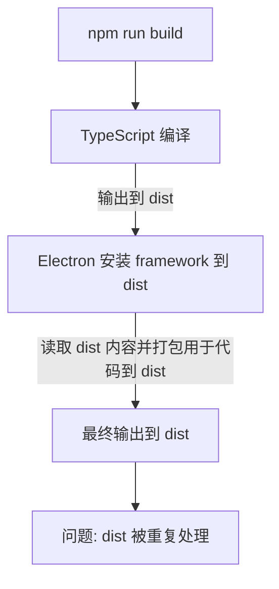

## 前言

最近在开发 electron 应用，打包时安装包巨大无比，然后就让我花了整整一天的时间 debug，今天刚准备下班，终于发现问题在哪里了！

首先，我的项目采用了微前端+微后端的层次架构，所以整个 electron 项目的代码量其实非常非常小，项目样例：https://github.com/LSTM-Kirigaya/openmcp-client/tree/main/software

build 的时候会先将 src/ 下的 桥接层 代码编译到 dist 下，然后再启动 electron-builder 构建最终的文件。但是我构建下来的 dmg 安装包居然有 220MB 大小！这是不可接受的。

---

## 解决历程

然后我翻遍了整个互联网，寻找如何优化 electron 大小，我尝试了一圈都收效甚微，这个时候我灵机一动，想到了去下载模板项目先看看正常大小应该是多大。我下载了 https://github.com/electron-vite/electron-vite-vue.git 这个模板项目，build 了一下，它的产物只有 98MB ！

然后我赶紧把它的配置文件和我的配置文件进行了对比，不得不说，electron 模板项目的配置文件就没有一个是简单的，上面这个 `electron-vite-vue` 算是配置文件最简单的了，我一下子就看到了差别，原来这是我的问题哈哈哈。

我截取我写的 package.json 中的一小段：

```json
	"build": {
		"appId": "com.electron.openmcp",
		"productName": "OpenMCP",
		"asar": true,
		"asarUnpack": "*.node",
		"directories": {
			"output": "dist"
		},
		"files": [
			"dist/**/*",
			"resources/**/*",
			"icons/**/*"
		],
```

electron 会根据这一段来执行最终的 build。问题就在于这个 output 参数，它是 dist，这是不对的，因为 electron 会将 files 下的所有文件全部打包带走，然后塞入 output 里面。这个过程不是一次性完成的，而是会分为好几个阶段，也就是说，output 指定的文件夹是会慢慢变大的。

这就很好玩了，因为我把 typescript 第一次编译的目标路径和 electron 打包的路径都设置为了 dist，所以当我运行 npm run build 时，实际上发生了这个事情：




这就导致了 electron 的 framework 部分被安置了两次，所以体积变成了正常大小的大约两倍。知道这个哭笑不得的问题后，只需要这么改就ok了：

```json
"directories": {
            "output": "release"
        },
```

把 output 改成非 release 的字符即可。下次遇到这种体积偏大的问题，一定要好好理解清楚全流程，再通过逻辑去判断最终答案。

---

最后推荐一个非常好用的图标制作网站 [https://icon.kitchen/](https://icon.kitchen/)