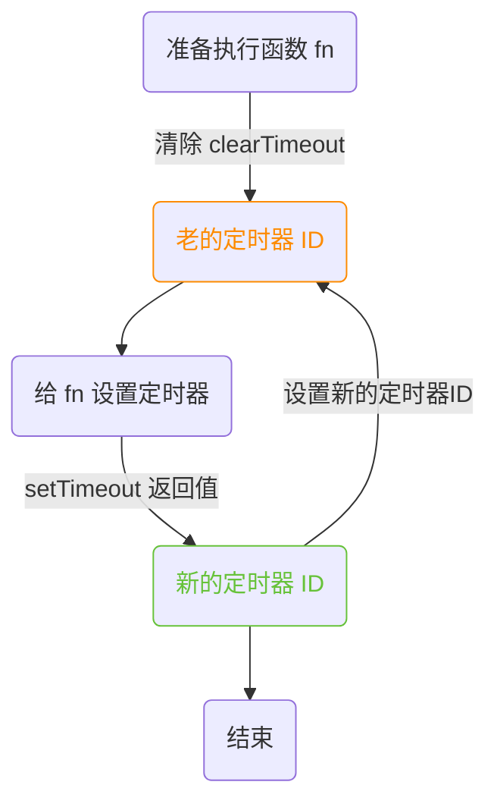

## 介绍

防抖函数是每一个高频、单次访问延时高的请求必要的函数包装接口，它能够让一个根据用于输入发送请求的接口不会在 `delay` 间隔内连续发送两次请求。

它的实现原理非常简单，只需要在虚假执行一个函数前将它包裹在一个 `setTimeout` 中，再次执行它时根据 `setTimeout` 返回的 timer id 进行 `clearTimeout` 即可。防抖的单词执行原理逻辑如下：

<center>

</center>

我们要做的只是将上面的过程包装成一个函数增强方法即可。下面是我经常使用的 TS 和 JS 中的实现方式。

## TypeScript

```typescript
interface EndFunction<P> {
    (...args: P[]): void;
}

function debounceWrapper(fn: EndFunction<any>, delay: number): EndFunction<any> {
    let timerID : null | number = null;
    function invoker(...args: Parameters<EndFunction<any>>): void {
        if (timerID !== null) {
            clearTimeout(timerID);
        }

        timerID = setTimeout(() => {
            fn(...args);
        }, delay);
    }
    return invoker;
}
```


## JavaScript

```javascript
function debounceWrapper(fn, delay) {
    let timer
    return function () {
        if (timer) {
            clearTimeout(timer)
        }
        timer = setTimeout(() => {
            fn()
        }, delay)
    }
}
```
