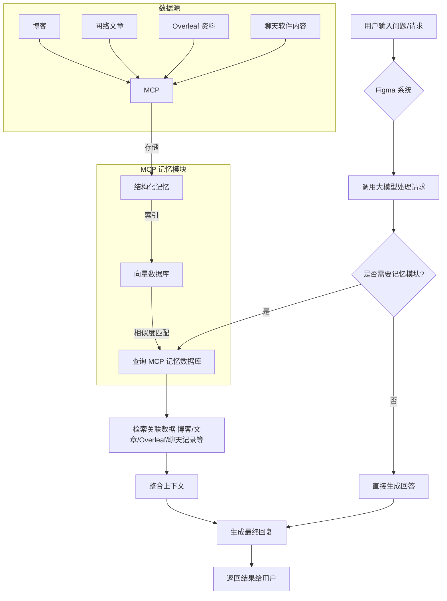

## collections

- [openmemory](https://app.openmemory.dev/dashboard)
- [openmcp](https://kirigaya.cn/openmcp/)



---

## prompts

### DustBlog

```python
title = '觉得 MCP 太消耗 token？ 不妨试试这款插件，让你使用网页版本大模型也可以使用 MCP！'
tags = ','.join(['MCP', '项目推荐'])
format_time = 'Jun 11, 2025'
content = '...'

prompt = """
这篇文章的标题为《f{title}》，标签为 f{tags}。文章的链接为 {url} 。锦恢发表于他的个人网站汇尘轩，发表时间为 f{format_time}。请为这些信息进行记忆存储。

文章的内容如下，请以自然段为单元一步一步地进行记忆存储，记住请过滤没有信息含量的信息：
f{content}
"""
```

### Zhihu

```python

```


### Document