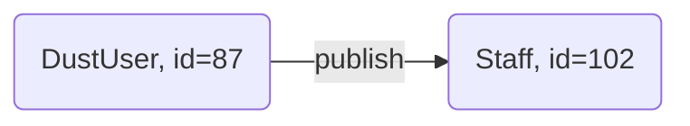

`neo4j`作为图数据库，使用`cypher`语言进行查询。类似于`MySQL`的SQL语句，`cypher`只对关键字不区分大小写，其余区分大小写。

## Cypher语句

下面会通过几个例子来看看CURD怎么执行。

---

### 创建

使用`create`关键字

#### 创建名(name)为"Neo4j基本使用"的博客(Blog)节点

```cypher
create (n:Blog{name:"Neo4j基本使用"}) return n
```

如果需要指定创建时，节点的ID，可以如下使用：

```cypher
create (n:Blog{name:"Neo4j基本使用"}) set n.id=xxx return n
```

> 可以看到，属性名类似于`json`，key不需要双引号，value如果是字符串一定需要双引号

#### 创建关系

将id为102的Staff节点和id为87的User节点之间创建一个关系：

<center>

</center>

```cypher
match (s:Staff) where id(s)=102
match (n:DustUser) where id(n)=87
create (n)-[r:Publish]->(s)
return s,n
```

---

### 查询

查询通过`match`和`return`进行

#### 查询所有的博客(Blog)节点

```cypher
match (n:Blog) return n limit 25
```

> 通过`limit`来限制查询到的节点数量

#### 基于 id 查询

neo4j 默认会给每一个创建的节点生成唯一的id，这也是绝大多数数据库默认的主键。用 id 查询节点的方法如下：

```cypher
match (n:Blog) where id(n)=xxx return n
```


#### 查询名(name)为"Neo4j基本使用"的博客(Blog)节点

法一：

```cypher
match (n:Blog{name:"Neo4j基本使用"}) return n
```

法二：

```cypher
match (n:Blog) where n.name="Neo4j基本使用" return n
```


嵌套查询常使用`with`来连接两个查询，将一个查询的结果作为另一个查询的条件，老版本的`cypher`支持对关系做乘法，以此来进行多跳查询，比如我现在希望查询和"Neo4j基本使用"这篇文章属于同一个话题的文章，很显然，这是一个跳数为2的查询，最简单的写法为：

```cypher
match (n:Blog{name:"Neo4j基本使用"})-[r * 2]-(m) return m
```

`*n`代表n跳查询，但是这个特性对性能有很大的影响，因此新版本的`neo4j`即将丢弃这个特性，我们可以使用`with`的嵌套查询来实现同样的效果：

```cypher
match (n:Blog{name:"Neo4j基本使用"})-[r]-(m:Topic) with m match (m:Topic)-[r]-(n:Blog) return n
```


---

### 修改

修改配合`match`与`set`即可完成：

#### 将"Neo4j基本使用"的图片链接(imgUrl)换成"https://image.jpg"

```cypher
match (n:Blog{name:"Neo4j基本使用"}) set n.imgUrl="https://image.jpg"
```

---

### 删除

删除配合`match`与`delete`即可完成：

#### 删除"Neo4j基本使用"

```cypher
match (n:Blog{name:"Neo4j基本使用"}) delete n
```


> ## 如果删除的节点存在连边的话，上面的写法会报错，需要加一个`detach`

```cypher
match (n:Blog{name:"Neo4j基本使用"}) detach delete n
```

---

## 绝密

关于我的服务器上的 neo4j 所在地。

安装地点：/usr/local/neo4j

启动方法：

```bash
$ /usr/local/neo4j/bin/neo4j restart
```