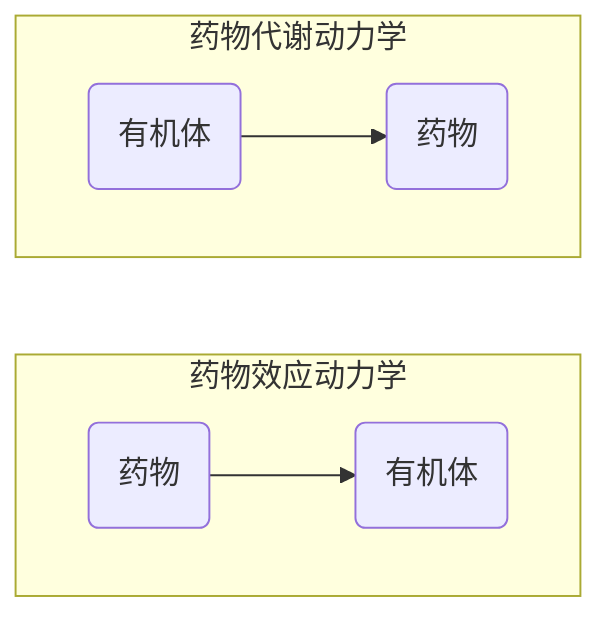

## 药理学绪论

- 药理学 p1
- 药物效应动力学（pharmacodynamics，简称药效学）：研究药物对有机体的作用及其作用机制。
- 药物代谢动力学（pharmacokinetics，简称药动学）：研究药物在有机体的影响下发生的变化及规律。

---

## 药物效应动力学

- 不良反应类型和举例 p23 p37
- 量效关系 p23
- 效能，效价强度 p24
- 治疗指数 p25
- 作用于受体药物的分类 p27 28

## 药物代谢动力学

- 影响吸收和分布的因素 ppt16 ~ 30
- 肝药酶抑制剂和诱导剂 ppt 西咪替丁 华法林
- 肾脏排泄三个过程
- 一级消除动力学，零级消除动力学 ppt47
- 半衰期 p53
- 生物利用度 p50
- 表观分布容积 p51

> 药物作用机制、临床应用、特殊不良反应

## 传出神经系统药物

- 毛果芸香碱 p54
- 新斯的明，毒扁豆碱，有机磷中毒，解磷定 p60～63
- 阿托品，东莨菪碱，山莨菪碱 p66～68
- 肾上腺素，去甲肾上腺素 p77&p87
- 异丙肾上腺素
- 酚妥拉明，普萘洛尔

## 中枢神经系统药物

- 地西泮 p118
- 苯妥英钠 ppt22-25
- 氯丙嗪 ppt37-42
- 碳酸锂 ppt51
- 丙咪嗪 p150
- 氟西汀 p153
- 吗啡 ppt57-64 68 书p161
- 喷他佐辛 p164
- 纳洛酮 p166
- 阿司匹林 ppt79-82 机制ppt73-76
- 对乙酰氨基酚，布洛芬 ppt83-85

## 心血管系统药物

- 抗心律失常药分类 p194+ppt15
- 抗高血压药分类 p219
- 利尿药分类 p209
- 抗心衰药 ppt36
- 抗心绞痛药分类 ppt47
- 利多卡因 p196
- 胺碘酮 p198
- 维拉 p199
- 帕米，普萘洛尔 p197+ppt26
- 呋塞米，氢氯噻嗪，螺内酯 ppt23、24、25
- 卡托普利，缬沙坦 ppt30 ppt31
- 硝苯地平 ppt28
- 地高辛 ppt37-39
- 多巴酚丁胺 ppt41
- 硝酸甘油 p49

## 内分泌系统药物

- 胰岛素 ppt9+12-14
- 二甲双胍，阿卡波糖，格列齐特 ppt15-22
- 糖皮质激素（强的松龙，地塞米松） ppt24-30
- 丙基硫氧嘧啶，大剂量碘 ppt37 p340-342

## 抗菌药

- 抗菌药物的作用机制 ppt6
- 青霉素类
- 头孢菌素类
- 氨基糖苷类
- 喹诺酮类
- 磺胺类

## 抗恶性肿瘤药

- 分类，作用机制 ppt30-32
- 共有的毒性反应 p458