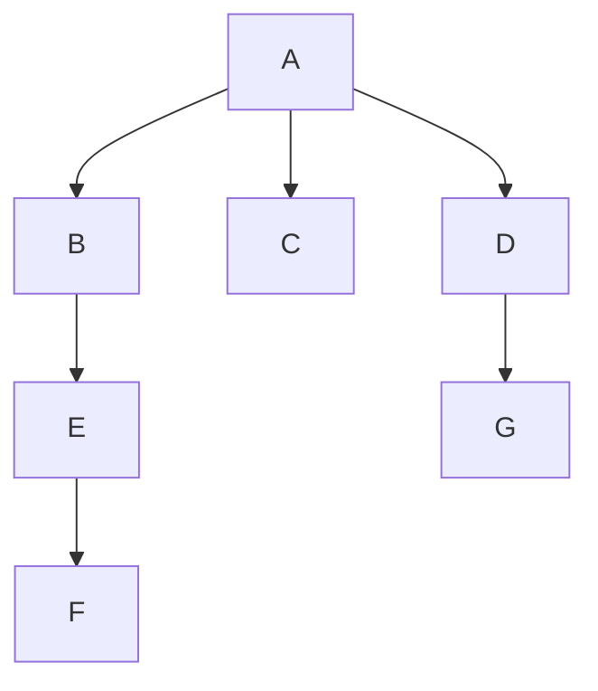
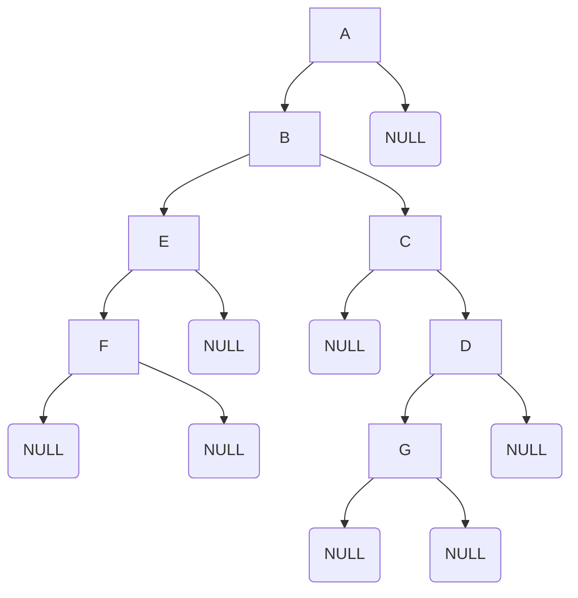
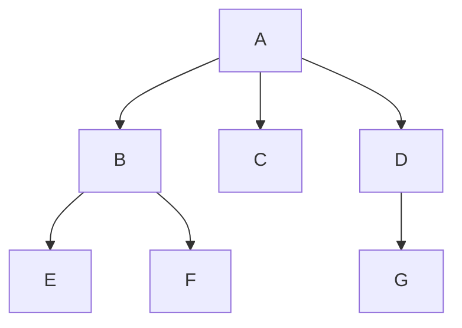
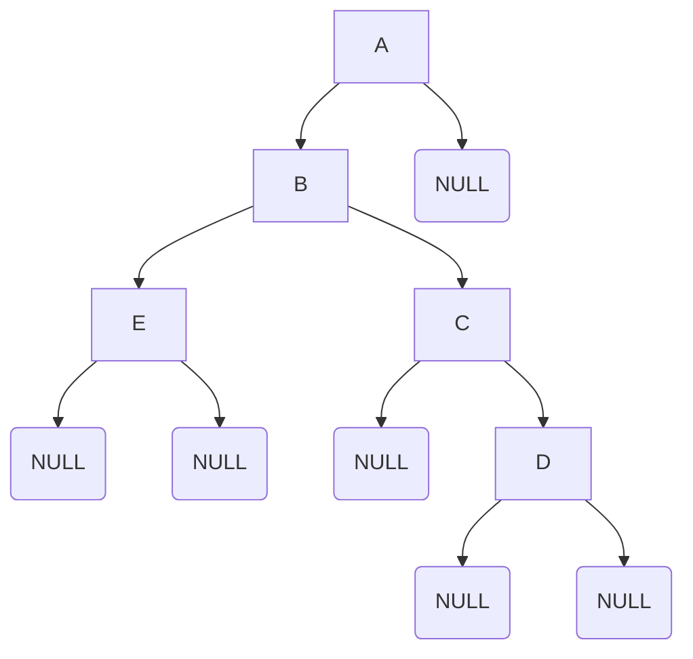
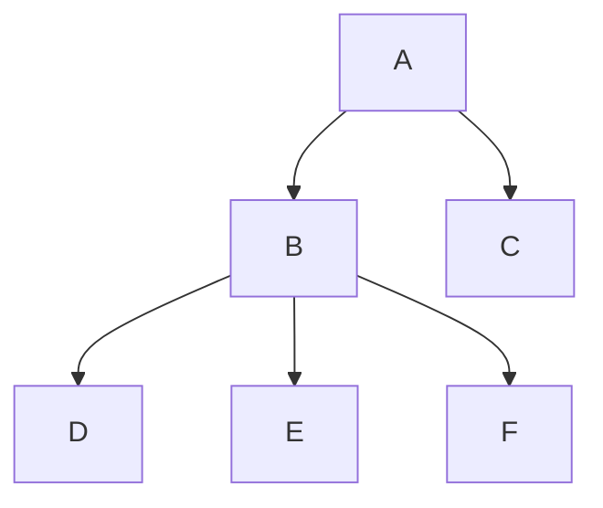
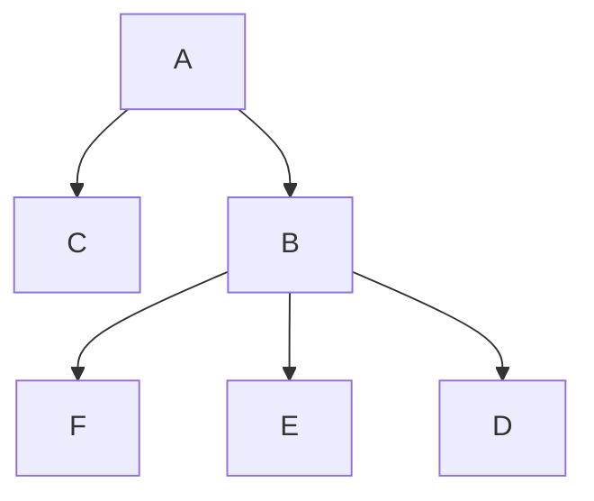

## 前言
我们都知道如何表达一颗二叉树：使用结构体记录每个节点的数据(`data`)，指向左节点的指针(`*left`)和指向右节点的指针(`*right`)。我们一般会把二叉树节点的结构体定义如下：
```c
typedef struct node
{
	char data;		// 节点数据	
	struct node *left, *right;	// 指向左节点和右节点的指针
}BT;
```
但是多叉树就不好这么表示了，因为我们不知道多叉树的每个节点的子节点上限是多少，这样多叉树节点的结构体就不好写了。因此实际操作时，我们一般会把多叉树写成二叉链的形式：
```c
typedef struct node
{
    char data;		// 节点数据
    struct node *fir, *sib;		// 指向第一个子节点和下一个兄弟节点的指针
}TR;
```
我们把上述儿子兄弟的节点表达方式成为多叉树的二叉链表达。举个例子，比如我们的多叉树长这个样子：

则它的二叉链表达为：

每个节点的依旧只有左右节点，但是它们的实际含义已经和二叉树节点的左右节点不一样了。比如当前我们考察的节点为`node`，则**二叉链**中`node`的左节点(`node.fir`)代表`node`的第一个子节点，可以发现图中`E`的左节点为`F`，说明`F`是`E`的第一个子节点；`C`的左节点为`NULL`，说明`C`没有子节点。这些观察都符合原来在多叉树中的观察结果。
`node`的右节点`node.sib`代表`node`的兄弟节点，也就是在多叉树中与`node`同层且在`node`右侧的那一个节点。比如`C`的右节点为`D`，说明在多叉树中，`C`的同层的右边那个节点为`D`，这也是合理的。

继而对于这样的树的操作与二叉树相比会有所不同。下面在这样的一颗多叉树上实现如下的功能：
```c
TR *createTR(char *in, char *pre, int k);   //  创建一棵树
void showTR(TR *T);     // 展示一棵树   A(B,C(E,F))这样的形式
TR *destroy(TR *T);     //  销毁一棵树
void preorder(TR *T);   // 前序遍历
void postorder(TR *T);  // 后序遍历
void layer(TR *T);      // 层次遍历
int height(TR *T);      // 树的高度
int leaf(TR *T);        // 计算叶子的数量
void getpath1(TR *T);   // 打印根到叶子节点的所有路径(dfs)
void allpath(TR *T,char *path,int n);   // 配合getpath1完成递归
void getpath2(TR *T);   // 基于后序遍历的非递归找路径
void getpath3(TR *T);   // 基于层次遍历的非递归找路径
void longestPath(TR *T);    // 输出根节点到叶子节点所有路径中最长的那些路径 
void insert(TR *T, char s1, char s2);  // 在data为s1的节点下插入data为s2的子节点
// 若s1有子节点，则将s2放入s1的末尾；若s1没有子节点，则将s2作为新的节点插入
TR *delsub(TR *T, char s);      // 递归地销毁根节点data为s的子树
TR *lca(TR *T, char s1, char s2);   // 寻找s1和s2的最近公共祖先
void mirror(TR *T);     // 多叉树逆置
```
具体细节有时间再写~~~

---

## 创建多叉树
我们使用多叉树对应的二叉链的前序遍历与中序遍历作为输入创建一颗多叉树，这和二叉树的创建几乎无异。
```c
TR *createTR(char *in, char *pre, int k)
{
    if (k <= 0)
    {
        return NULL;
    }
    else
    {
        TR *node = new TR;         // 创建一个新节点
        node->data = pre[0];      // 新节点的data为当前先序遍历的开头，也就是本层递归创建的树的根节点
        int i;
        for (i = 0; in[i] != pre[0]; ++ i);     // 在中序遍历中寻找根节点，i代表根节点在中序遍历中的索引
        node->fir = createTR(in, pre + 1, i);	// 创建二叉链的左分支的根节点
        node->sib = createTR(in + i + 1, pre + i + 1, k - i  - 1);	// 创建二叉链的右分支的根节点
        return node;
    }
}
```

---

## 展示多叉树
我们将以前序的顺序输出一颗多叉树，假设我们的多叉树如下：


那么我们的输出为
```
A(B(E,F),C,D(G))
```
代码如下：
```c
void showTR(TR *T)
{
    if (T)
    {
        cout << T->data;
        if (T->fir)
        {
            cout << "(";
            TR *p = T->fir;
            showTR(p);
            p = p->sib;
            while (p)
            {
                cout << ",";
                showTR(p);
                p = p->sib;
            }
            cout << ")";
        }
    }
}
```

---

## 销毁一颗多叉树
销毁以`T`为根节点的一整颗多叉树。通过递归实现。
```c
TR *destroy(TR *T)
{
    if (!T)
    {
        return NULL;
    }
    else
    {
        TR *p = T->fir, *p2;
        while(p)
        {
            p2 = p->sib;     // 因为p会被销毁，所以需要一个p2来保存指向的节点地址
            destroy(p);
            p = p2;
        }
        delete T;
        return NULL;
    }
}
```
---

## 前序遍历(递归&非递归)
多叉树的前序遍历写法和二叉树的一模一样，这里提供递归和非递归两种写法。
### 递归写法
递归写法没什么好说的，直接写就是了。
```c
void preorder(TR *T)
{
    if (T)
    {
        cout << T->data << " ";
        preorder(T->fir);
        preorder(T->sib);
    }
}
```

### 非递归写法
非递归通过栈的数据结构来完成，也就是每次弹栈时将弹出元素的右左节点依次入栈。
```c
void preorder(TR *T)
{
    TR *s[N], *p;       // 使用栈来模拟递归
    int top = 0;
    s[top] = T;     // 根节点先入栈

    while (top >= 0)
    {
        p = s[top --];  // 先取出栈顶元素
        cout << p->data << " ";

        // 按先右再左的顺序将出栈元素的fir和sib入栈
        if (p->sib)
        {
            s[++ top] = p->sib;
        }     
        if (p->fir)
        {
            s[++ top] = p->fir;
        }
    }
}
```

---

## 后序遍历(递归&非递归)
由于多叉树的子节点数量不确定，所以在多叉树中无法实现中序遍历，因此，只有前序遍历、后序遍历和层次遍历。

关于后序遍历，可以证明，多叉树（二叉链，也就是儿子兄弟表示法）的后序遍历等同于二叉树的中序遍历。因此，我们只需要把二叉树中中序遍历的写法应用到多叉树的后序遍历中就行了。此处同样提供递归与非递归两种写法。
### 递归写法

```c
void postorder(TR *T)
{
    if (T)
    {
        postorder(T->fir);
        cout << T->data << " ";
        postorder(T->sib);
    }
}
```

### 非递归写法
非递归写法同样是使用栈的数据结构，需要注意的是，我们需要每次都把最靠左的分支先搜索完。再进入右分支。

```c
void postorder(TR *T)
{
    // 多叉树的后序遍历的写法对应于二叉树的中序遍历
    TR *s[N], *p = T;
    int top = -1;

    while (top >= 0 || p)
    {
        // 先将目前节点的全部子节点入栈
        while (p)
        {
            s[++ top] = p;
            p = p->fir;
        }
        // 打印栈顶元素，并进入栈顶元素的兄弟节点
        p = s[top --];
        cout << p->data << " ";
        p = p->sib;
    }
}
```

---

## 层次遍历
层次遍历一般通过非递归的写法实现，我们通过队列的数据结构来实现。基本原理和二叉树的层次遍历几乎无异：每次讲一个元素弹栈后，将该元素的所有的子节点入队。只不过此时要通过`sib`指针来遍历获得一个节点下所有的子节点。
```c
void layer(TR *T)
{
    TR *q[N], *p;       // 通过队列来完成层次遍历
    int front, rear;
    front = rear = 0;
    q[rear ++] = T;     // 根节点先入队

    while (front != rear)       // 循环的结束条件为队列为空
    {
        // 基本逻辑很简单，每打印队首的元素，就将队首的所有节点全部入队
        p = q[front ++];
        cout << p->data << " ";
        p = p->fir;

        while (p)
        {
            q[rear ++] = p;
            p = p->sib;
        }
    }
}
```

---

## 计算多叉树的高度
同二叉树一样，此处还是通过递归完成高度的计算。不同的是，左右节点递归返回的高度的意义不一样：多叉树的二叉链表示中，左节点代表它的第一个子节点，右节点代表下一个兄弟节点，显然兄弟节点会相对高处子节点，所以我们需要对返回的左节点加一，以保证它和右节点在“同一个高度”进行比较。
```c
int height(TR *T)
{
    if (!T)
    {
        return 0;
    }
    else
    {
        int h1, h2;
        h1 = height(T->fir) + 1;       // 由于T的子节点比兄弟节点低一层，所以需要加一
        h2 = height(T->sib);
        return max(h1, h2);
    }
}
```

---

## 计算多叉树叶子节点的个数
一个简单的递归就可以完成，不过请注意二叉链的结构特征。用`mermaid`画个图举个例子：

递归边界自然是`T==NULL`时，此时返回0就行；如果在`T`非空的情况下，`T->fir==NULL`，说明当前的`T`是二叉链中的一个出度为1的点，同时也是原来的多叉树中的一个叶子，比如图中的`C`点，这个时候`C`应该把`D`的递归结果`leaf(T->sib)`(此处假设`T->data=='C'`)返回，否则最后传到根节点`A`时，`D`分支的叶子数量信息就丢失了；同时`C`递归返回的信息还需要+1，因为`C`本身就是多叉树中的叶子。

如果是二叉链中出度为2的节点，比如`B`，它本身在多叉树中也不是叶子，所以直接把两个分支的统计情况加起来向上递归即可。

总的程序如下：

```c
int leaf(TR *T)
{
    if (!T)
        return 0;
    else if (!T->fir)
        return 1 + leaf(T->sib);	// 二叉链的结构特性导致需要把兄弟节点返回的个数加一
    else  
        return leaf(T->fir) + leaf(T->sib);
}
```

---

## 打印输出根节点到所有叶子节点的路径(深度优先-递归)

此处通过两个函数完成：`getpath1`函数负责完成存储路径的数组`*path`的创建，并把根节点加入`*path`中，然后调用`allpath`函数；`allpath`函数通过递归实现深度优先搜索。

代码如下：

```c
void getpath1(TR *T)
{
    char path[N];
    path[0] = T->data;
    allpath(T, path, 1);
}

void allpath(TR *T, char *path, int n)
{
    if (!T->fir)
    {
        for (int i = 0; i < n; ++ i)
            cout << path[i] << " ";
        cout << endl;
    }
    if (T->fir)
    {
        path[n] = T->fir->data;
        allpath(T->fir, path, n + 1);
    }
    if (T->sib)
    {
        path[n - 1] = T->sib->data;
        allpath(T->sib, path, n);
    }
}
```

---

## 打印输出根节点到所有叶子节点的路径(基于后序遍历-非递归)
由于我们是通过栈实现非递归的后序遍历，这带来一个好处：每次将叶子节点弹出栈时，由于其父节点先入栈，所以叶子节点的父节点往上的一堆节点都还在栈中。我们可以利用这一特性，在每次弹出叶子节点时，顺便将栈中元素全部打印，这就是我们需要的路径了。代码如下：
```c
void getpath2(TR *T)    // 基于后序遍历的路径搜索
{
    TR *s[N], *p = T;
    int top = -1;

    while (top >= 0 || p)
    {
        while (p)
        {
            s[++ top] = p;
            p = p->fir;
        }

        p = s[top];
        if (!p->fir)    // 当前弹出的元素没有子节点，说明该节点为叶子，打印此时的栈内元素便是路径
        {
            for (int i = 0; i <= top; ++ i)
                cout << s[i]->data << " ";
            cout << endl;
        }
        top --;
        p = p->sib;
    }
}
```

---

## 打印输出根节点到所有叶子节点的路径(基于层次遍历-非递归)
由于层次遍历的过程中，不断有节点的父节点被弹出，因此，我们需要记录每个节点的父节点在队列中的位置，这样，一旦我们找到一个叶子节点，就可以顺着父亲节点的索引一路倒着将路径打印出来了。

为此我们创建一个结构体`QU`：
```c
typedef struct queue
{
    int fa;		// 记录node节点的父节点在队列中的索引
    TR *node;		// 指向TR节点的指针
}QU;
```

代码如下：
```c
void getpath3(TR *T)
{
    QU q[N];
    TR *p;
    int front, rear;
    front = rear = 0;
    q[rear].node = T;
    q[rear].fa = -1;
    rear ++;

    while (front != rear)
    {
        p = q[front].node;
        if (!p->fir)
        {
            for (int i = front; i != -1; i = q[i].fa)
                cout << q[i].node->data << " ";
            cout << endl;
        }
        else
        {
            p = p->fir;
            while (p)
            {
                q[rear].node = p;
                q[rear].fa = front;
                rear ++;
                p = p->sib;
            }
        }
        front ++;
    }
}
```
---

## 输出根节点到叶子节点所有路径中最长的那些路径 
思路很简单，我们先通过`height`函数计算出树的高度，这个高度不就等于整棵树所有根节点到叶子节点的路径中最长路径长度吗？

然后通过上述的三种打印路径的算法，每次打印路径前，都统计一下打印路径的长度，如果长度等于树的高度，说明这是一条最长的路径，那么就打印；反之，则不打印。

```c
void longestPath(TR *T)
{
    int max_length = height(T);

    QU q[N];
    TR *p;
    int front, rear;
    front = rear = 0;
    q[rear].fa = -1;
    q[rear].node = T;
    rear ++;

    while (front != rear)
    {
        p = q[front].node;
        if (!p->fir)
        {
            int length = 0;
            for (int i = front; i != -1; i = q[i].fa)
                length ++;
            if (length == max_length)
            {
                for (int i = front; i != -1; i = q[i].fa)
                    cout << q[i].node->data << " ";
                cout << endl;
            }
        }
        else
        {
            p = p->fir;
            while (p)
            {
                q[rear].fa = front;
                q[rear].node = p;
                rear ++;
                p = p->sib;
            }
        }
        front ++;
    }
}
```

---

## 递归实现节点的插入
我再把这个函数做的事情说得清楚些：在data为s1的节点下插入data为s2的子节点。若s1有子节点，则将s2放入s1的末尾；若s1没有子节点，则将s2作为新的节点插入。
这个就比较简单了，不再过多废话了。
```c
void insert(TR *T, char s1, char s2)        // 递归实现节点的插入
{
    if (T)
    {
        if (T->data == s1)
        {
            TR *node = new TR;
            node->fir = node->sib = NULL;
            node->data = s2;
            if (T->fir)		// 当前节点有子节点，则找到最后一个子节点
            {
                TR *p =  T->fir;
                while (p->sib)
                    p = p->sib;
                p->sib = node;
            }
            else	// 当前节点没有子节点，则直接作为当前节点的子节点
            {
                T->fir = node;
            }
        }
        else
        {
            insert(T->fir, s1, s2);
            insert(T->sib, s1, s2);
        }
    }
}
```

---

## 删除子树
功能：给定多叉树的根节点和需要删除的节点的`data`。删除以`data`为根节点的子树。

这个需要注意，如果我们删除的节点有兄弟节点，我们就需要把它的兄弟节点和之前的节点接上，否则一删除该节点，其兄弟节点后面那一块也都全没了=_=

```c
TR *delsub(TR *T, char s)
{
    if (!T)
    {
        return NULL;
    }
    else if (T->data == s)
    {
        return destroy(T);
    }
    else
    {
        if (T->fir && T->fir->data == s)	// 如果当前节点的子节点就是我们要删除的节点，则需要把其子节点的兄弟节点做处理（当然，如果）
            T->fir = T->fir->sib;
        delsub(T->fir, s);

        if (T->sib && T->sib->data == s)
            T->sib = T->sib->sib;
        delsub(T->sib, s);
        return T;
    }
}
```

---

## 递归实现最近公共祖先查询
最近祖先又称为`lca`，相信看到这里的同学都知道`lca`是怎么一回事，我就懒得写了。直接上代码：

```c
TR *lca(TR *T, char s1, char s2)
{
    if (!T)
        return NULL;
    if (T->data == s1 || T->data == s2)
        return T;
    else
    {
        TR *s[3], *p = T->fir, *q;	// s数组记录以T的各个子节点为根节点进行的lca查询中，返回值非NULL的那些节点
        int top = 0;
        while (p)
        {
            q = lca(p, s1, s2);
            if (q)
                s[top ++] = q;
            p = p->sib;
        }

        if (top == 0)
            return NULL;
        if (top == 2)
            return T;
        else
            return s[0];        
    }
}
```

---

## 多叉树逆置
将一颗多叉树做镜像，比如我们的多叉树如下：


那么逆置后的多叉树如下：

代码如下，我们通过递归来实现：

```c
void mirror(TR *T)
{
    TR *p, *p2;
    if (!T || !T->fir)
        return;
    else
    {
        p = T->fir;
        T->fir = NULL;
        while (p)       // 通过头插法来逆置
        {
            mirror(p);
            p2 = p->sib;
            p->sib = T->fir;
            T->fir = p;
            p = p2;
        }
    }
}
```

---

## 验证

最后可以通过如下的主函数验证函数结果：

```c
#include <iostream>
#include <cstring>
#include <cstdio>
#include <cmath>
#define N 100
using namespace std;

main()
{
    char pre[]="ABEFCDGHIJ",in[]="EFBCHIJGDA";  // 目标多叉树对应的二叉链的先序遍历和中序遍历
    TR *header = NULL;
    int length = strlen(pre);

    header = createTR(in, pre, length); // 创建一颗多叉树
    cout << "创建的树为:" << endl;
    showTR(header);
    cout << endl;

    cout << "前序遍历:" << endl;
    preorder(header);
    cout << endl;

    cout << "后序遍历:" << endl;
    postorder(header);
    cout << endl;

    cout << "层次遍历:" << endl;
    layer(header);
    cout << endl;

    cout << "树的高度为:" << endl;
    cout << height(header) << endl;

    cout << "树的叶子数量为:" << endl;
    cout << leaf(header) << endl;

    cout << "从根节点到子节点的所有路径(递归):" << endl;
    getpath1(header);
    cout << endl;

    cout << "从根节点到子节点的所有路径(后序遍历):" << endl;
    getpath2(header);
    cout << endl;

    cout << "从根节点到子节点的所有路径(层次遍历):" << endl;
    getpath3(header);
    cout << endl;

    cout << "根节点到叶子节点的最长路径有：" << endl;
    longestPath(header);
    cout << endl;

    cout << "插入新节点后的树:" << endl;
    insert(header, 'E', 'X');
    insert(header, 'A', 'K');
    insert(header, 'I', 'L');
    showTR(header);
    cout << endl;

    TR *p;
    p = lca(header, 'X', 'F');
    cout << "距离X和F最近的共同祖先是:" << p->data << endl;
    p = lca(header, 'K', 'L');
    cout << "距离K和L最近的共同祖先是:" << p->data << endl;
    p = lca(header, 'L', 'H');
    cout << "距离L和H最近的共同祖先是:" << p->data << endl;

    cout << "删除I分支后，树为:" << endl;
    header = delsub(header, 'I');
    showTR(header);
    cout << endl;

    cout << "删除E分支后，树为:" << endl;
    header = delsub(header, 'E');
    showTR(header);
    cout << endl;
    
    mirror(header);
    cout << "逆置后的多叉树为:" << endl;
    showTR(header);
    cout << endl;

    cout << "销毁树" << endl;
    destroy(header);
}

```

输出结果：
```
创建的树为:
A(B(E,F),C,D(G(H,I,J)))
前序遍历:
A B E F C D G H I J
后序遍历:
E F B C H I J G D A
层次遍历:
A B C D E F G H I J 
树的高度为:
4
树的叶子数量为:
6
从根节点到子节点的所有路径(递归):
A B E
A B F
A C
A D G H
A D G I
A D G J

从根节点到子节点的所有路径(后序遍历):
A B E
A B F 
A C
A D G H
A D G I
A D G J

从根节点到子节点的所有路径(层次遍历):
C A
E B A
F B A
H G D A
I G D A
J G D A

根节点到叶子节点的最长路径有：
H G D A
I G D A 
J G D A

插入新节点后的树:
A(B(E(X),F),C,D(G(H,I(L),J)),K)
距离X和F最近的共同祖先是:B
距离K和L最近的共同祖先是:A
距离L和H最近的共同祖先是:G
删除I分支后，树为:
A(B(E(X),F),C,D(G(H,J)),K)
删除E分支后，树为:
A(B(F),C,D(G(H,J)),K)
逆置后的多叉树为:
A(K,D(G(J,H)),C,B(F))
销毁树
```


