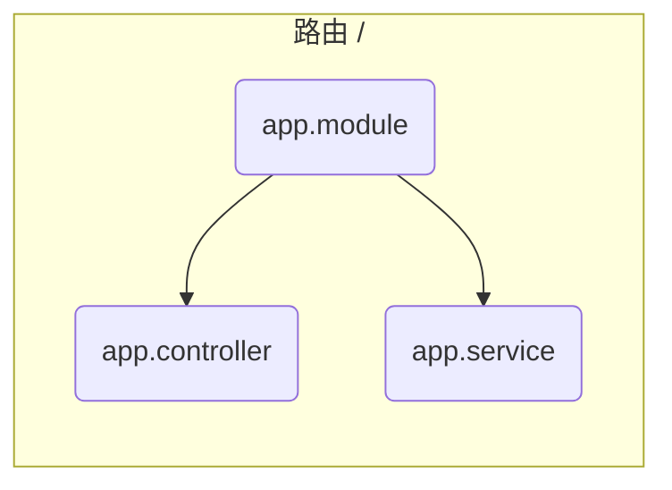
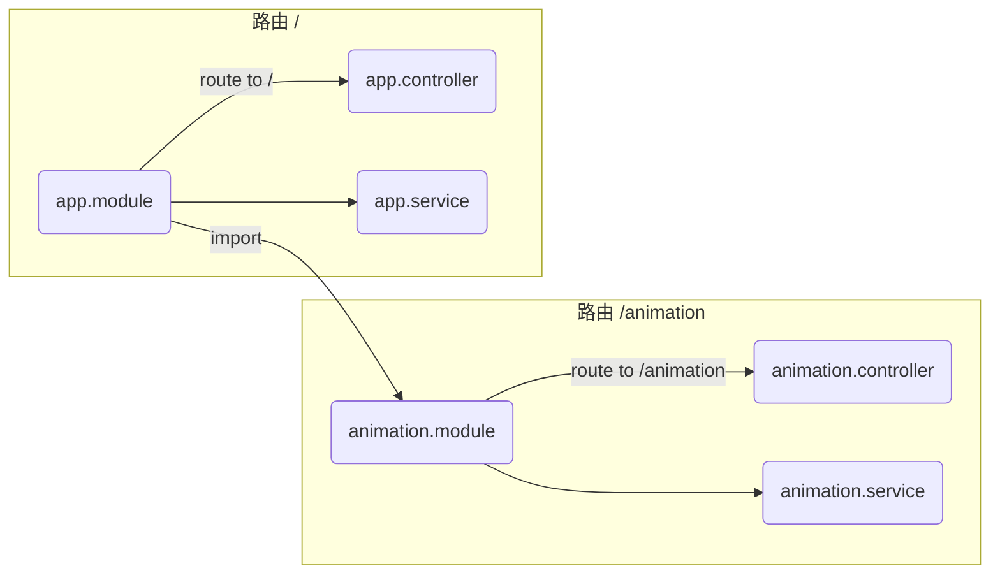

## NestJS

NestJS 是一个基于 Express（或 Fastify）的高层框架，它提供了更高级的抽象和结构，帮助开发者构建更可维护和可扩展的应用程序。

express 只是提供了基础的 http 服务的注册机制和各类基础网络方法的封装。但是如果你想要像 springboot 那样富有章法得开发一个维护性比较好的大型项目，往往需要在 express 上再设计自己的模型。NestJS 则是提供了一套完整的设计模型范式，让你可以像 springboot 那样开发你的后端应用。

👉 [NestJS 官方文档](https://docs.nestjs.com/first-steps)


## 快速开始

安装 nestjs 脚手架

```bash
npm i -g @nestjs/cli
```

创建项目 `learn-nestjs`

```bash
cd ~/projects
nest new learn-nestjs
```

### 基础项目结构

刚进入 nestjs 项目，你可以看到如下的项目结构

```bash
📦src
 ┣ 📜app.controller.spec.ts
 ┣ 📜app.controller.ts
 ┣ 📜app.module.ts
 ┣ 📜app.service.ts
 ┗ 📜main.ts
```

说明如下：

- app.controller.ts	只含有一个简单路由的基础 controller

- app.controller.spec.ts 上面那个 controller 的 UT
- app.module.ts	应用的根 module
- app.service.ts 只含有一个简单方法的基础 service
- main.ts 整个应用的入口文件

如果仔细去看 `main.ts`, 你会发现这里面也是比较简单的：

```typescript
import { NestFactory } from '@nestjs/core';
import { AppModule } from './app.module';

async function bootstrap() {
	const app = await NestFactory.create(AppModule);
	await app.listen(process.env.PORT ?? 3000);
}
bootstrap();
```

`NestFactory.create` 方法会裹挟 AppModule，返回一个满足 `INestApplication` 接口的对象，这里面会有不少通用方法被实现，从而选择一个端口开启后端应用。

### 选择你的 HTTP 框架

事实上，`NestFactory.create` 是一个范型函数，范型参数用来让您选择，您需要使用的底层 HTTP 框架是什么，目前 nestjs 支持 Express 和 Fastify ，默认是 Express。

```typescript
// 采用 Express
const app = await NestFactory.create<NestExpressApplication>(AppModule);

// 采用 Fastify
const app = await NestFactory.create<NestFastifyApplication>(AppModule);
```

### 启动服务

nestjs 默认提供了一组开发、格式化与打包的指令，详情可见 `package.json` 的 `scripts`，比如启动服务：

```bash
# 启动开发服务
npm run start

# 启动开发服务并进行热更新
npm run start:dev

# 启动 debug 模式开发服务并进行热更新
npm run start:debug

# 编译项目打包
npm run build
```

### 项目调试

我们先启动项目，然后进行项目调试，这是我们开始理解项目的伊始。

```bash
npm run start:dev
```

nestjs 默认起在 3000 端口上，默认只有一个根路由上的无参 get，所以可以这么验证：

```bash
curl http://localhost:3000/
```

返回结果：

```
Hello World!
```

这就是 nestjs 的基本用法了，代码层面不多解释，写过 springboot 并对 typescript 语法熟悉的朋友看这里的代码估计和回了家一样。具体请看官方文档中对各个功能子模块用法的介绍，请稍微花费半个下午看看这部分代码：

- [NestJS | Controllers](https://docs.nestjs.com/controllers)

- [NestJS | Providers](https://docs.nestjs.com/providers)
- [NestJS | Modules](https://docs.nestjs.com/modules)
- [NestJS | Middleware](https://docs.nestjs.com/middleware)

---

## 项目拓展

好吧，让我脱离上面那些无聊的用法，那些不是很重要。一个优秀的框架除了一开始的易用性，项目开发过程中的拓展也是非常重要的，比如我多了一个新的处理动画业务的模块 `animation`，如何在已有的 nestjs 项目上拓展这个新的业务模块呢？

### 对齐一下 nestjs 基本概念

如果你看明白了上面的部分，并且写过 springboot，那么就应该明白，在 nestjs 中，一个业务的基本单元是 module。module 又由 controller 和 service 组成，其中 controller 提供路由指南，service 提供每一个路由请求的具体实现。也就是如下的关系：



如果想要注册新的业务 animation，比如，注册到 `/animation` 下，那么理想情况下就应该是这个样子：



而 nest 提供了工具，让我们一口气快速生成 `/animation` 部分的所有框架级别的代码。


### 通过 nestjs 脚手架快速进行项目拓展

在进行大型项目开发或者快速迭代的时候，让我们自己手动创建符合上述架构的一系列文件不仅麻烦，而且不同开发成员的习惯不一定完全一样，这会导致迭代到后期的项目在缺乏 CI/CD 的情况下越来越不规范。所以强烈推荐使用 nest 工具直接创建 animation 这个业务模块：

```bash
nest generate resource animation
```

这会自动生成如下的项目结构：

```
📦src
 ┣ 📂animation
 ┃ ┣ 📂dto
 ┃ ┃ ┣ 📜create-animation.dto.ts
 ┃ ┃ ┗ 📜update-animation.dto.ts
 ┃ ┣ 📂entities
 ┃ ┃ ┗ 📜animation.entity.ts
 ┃ ┣ 📜animation.controller.spec.ts
 ┃ ┣ 📜animation.controller.ts
 ┃ ┣ 📜animation.module.ts
 ┃ ┣ 📜animation.service.spec.ts
 ┃ ┗ 📜animation.service.ts
 ┣ 📜app.controller.spec.ts
 ┣ 📜app.controller.ts
 ┣ 📜app.module.ts
 ┣ 📜app.service.ts
 ┗ 📜main.ts
```

熟悉 java springboot 的同学对于上面的生成的各个部分的代码应该还是很熟悉的。此处就不多解释了。


---

## CI/CD

NestJS 默认就安装了 Jest 测试框架进行本地的 CI/CD，如果你使用了 nest 脚手架创建项目，那么就会在项目中存在很多的以 `.spec.ts` 的文件，这些文件如同上文介绍的一样，是用于进行 UT 的文件。运行下面的命令就可以一次性激活所有由 spec 引导的 UT：

```bash
npm run test
```

当然，作为正规的 CI/CD，我们肯定需要 precommit 钩子来自动化帮我们进行 CI/CD 的各项事宜，一个比较简单的做法如下：

```bash
# 安装 husky，一个很好用的 commit 插件
npm install husky lint-staged --save-dev

# 初始化 husky
npx husky init
```

这样会在初始化一个 precommit 文件，这个文件里面的 bash 脚本会在 git commit 被执行前被自动执行，默认的 precommit 如下：

```bash
npm test
```

也就是每次提交前会运行一次 UT。更多关于 husky 进行本地初步 CI/CD 的内容我打算后续单独开一篇博客写写。

---

## 总结

这篇文章，给富有后端开发经验的同学简单讲解了一下 nestjs 框架的基本使用，学习资料和项目拓展方面，让你一天之内就能快速入门该框架的基本使用。更多的用法可以直接咨询 deepseek 或是在项目推进中进行。