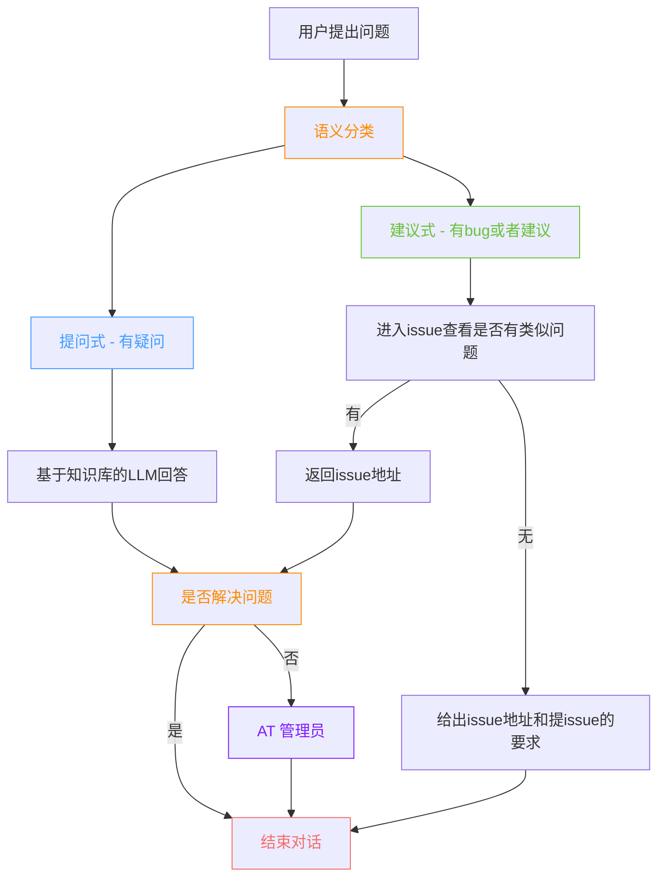

## 前言

作为DIDE项目的主要负责人之一，因为最近比较忙（科研工具+赶paper和实验），没有足够的时间回答群友的问题。因此我在思考如何设计一个闭式领域的问答机器人。

> 自从大模型横空出世后，我更加明确了一个智能问答系统需要做到的和不需要做到的事情。一个优秀的系统往往都是闭环的，因为工具的解决空间是有限的，只需要在有限的定义域内将问题导向正确的空间，工具本身就达到了它的目的。

在之前的博客中，我已经成功解决了新版QQ机器人的模拟登录：

- [Linux服务器Mirai部署（含Sign Server）](https://kirigaya.cn/blog/article?seq=104)
- [nonebot2前端 + mirai后端部署 QQ 机器人](https://kirigaya.cn/blog/article?seq=107)


## 状态机设计

现在要解决的就是一个可靠的回答程序了。先简单写一下设计的简单状态机。



不仅如此，实际实现时，要需要一个记录器，把每次最小对话的过程记录下来，以便进行后续的迭代升级。

---


## 意图识别 prompt

openai 官方的意图识别

```
SYSTEM:  You will be provided with customer service queries. Classify each query into a primary category and a secondary category. Provide your output in json format with the keys: primary and secondary.

Primary categories: Billing, Technical Support, Account Management, or General Inquiry.

Billing secondary categories: 
- Unsubscribe or upgrade
- Add a payment method
- Explanation for charge
- Dispute a charge

Technical Support secondary categories: 
- Troubleshooting
- Device compatibility
- Software updates

Account Management secondary categories: 
- Password reset
- Update personal information
- Close account
- Account security

General Inquiry secondary categories: 
- Product information
- Pricing
- Feedback
- Speak to a human
```


llama3 的返回结果：

```
Q: I need to get my internet working again.
A: {"primary": "Technical Support", "secondary": "Troubleshooting"}
Q: I'd like to know how much is the bagel?
A: {"primary": "General Inquiry", "secondary": "Product information"}
Q: Can you tell me more about the bagel?
A: { "primary": "General Inquiry", "secondary": "Product information" }
Q: I am having a password incorrect problem.
A: { "primary": "Account Management", "secondary": "Password reset" }
```

---


## RAG 设计

基于目前的主流技术，我打算使用 RAG 进行模型构建和设计。基本的框架 imClumsyPanda 大神已经画出来了

<div align=center>

</div>

其中的 LLM 部分交给专门训练基座模型的公司去折腾即可，比如使用[百度文心一言的API](https://kirigaya.cn/blog/article?seq=231)，剩下的部分就只剩一个查询模块了。为了可以让文本嵌入数据库，需要使用 embedding 模型。

中文文本一个显著特点就是中英混杂，所以选用支持中英双语的模型显得非常重要。我单独移到一篇文章中去介绍。