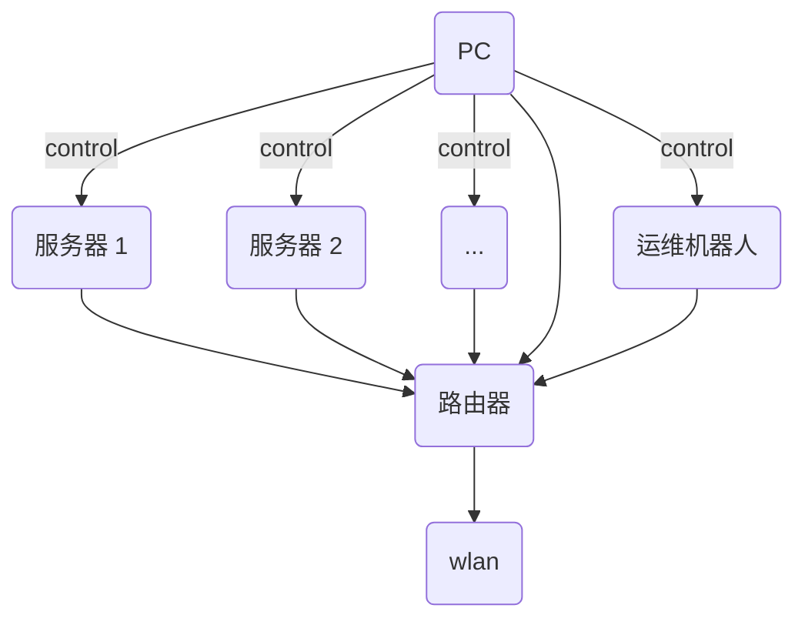

## 前言

记录一次愉快的 Ubuntu Server 安装经验。虽然我自己玩过了好几年的 Linux 服务器，但是说服务器的安装经验，我是真的没有。每当全栈工程师群聊，聊到装机和硬件部署时，总会和他们格格不入。

<div align=center>

</div>

正巧，我家里最近多出来了一台机器，而且我打算把我的个人网站的云服务器的一部分数据库负载扔到本地，云服务器只当作一个公网IP和小型 CDN 使用。因为这台多出来的机器上有显卡，我还打算在自己的服务器上部署一个开源大模型，并转接我的 QA 机器人，做灰度上线。我终于有一台属于我自己的 GPU 服务器了。

<div align=center>

</div>

既然要这么做，那么，我们自然需要在这台机器上安装新的 Linux 服务器（我比较喜欢 Ubuntu LTS），此处我选择 Ubuntu 22.04. 那么，开始吧！

---

## 原料

- 一台计算机 / 服务器
- 一个空间不小于 4G 的 U盘 或 移动硬盘
- 一台路由器 / 交换机 和 若干以太网网线
- 一台个人 Windows 操作系统的 PC 和显示器

---

## step.1 组网

我一般喜欢把组网放在第一步，你当然可以把服务器直接接入 wlan，但是考虑到未来的拓展性和管理，我个人建议接入路由器或者更加专业的服务器专用交换机中进行管理。两个原因：

- 把PC也接入路由器中就可以和服务器处于一个局域网内了，这样可很方便地通过 ssh 进行管理，而不需要再给服务器挂个显示器。
- 未来想要加入新的服务器，也非常方便，直接把新的服务器插入路由器的 LAN 即可。

基本的一个机架结构如下图所示：



接下来就开始做吧！正好在杂物间找到了一款老式的路由器，反正路由器也被我当作交换机用，老古董又不是不能用。

先把路由器的 WLAN 口接入 wlan，然后把需要接入路由器局域网的设备（PC，服务器，运维机器人）分别插入 LAN 口中。

<div align=center>

</div>

等待冒出绿光了，说明就完成了组网，在后续这些子模块上线后，我们可以在 PC 中如此测试内网的连通性：

```
$ ping lagrange.local

正在 Ping lagrange.local [172.168.1.101] 具有 32 字节的数据:
来自 172.168.1.101 的回复: 字节=32 时间<1ms TTL=64
来自 172.168.1.101 的回复: 字节=32 时间<1ms TTL=64
来自 172.168.1.101 的回复: 字节=32 时间<1ms TTL=64
来自 172.168.1.101 的回复: 字节=32 时间<1ms TTL=64

172.168.1.101 的 Ping 统计信息:
    数据包: 已发送 = 4，已接收 = 4，丢失 = 0 (0% 丢失)，
往返行程的估计时间(以毫秒为单位):
    最短 = 0ms，最长 = 0ms，平均 = 0ms

$ ping 172.168.1.102

正在 Ping 172.168.1.102 具有 32 字节的数据:
来自 172.168.1.102 的回复: 字节=32 时间<1ms TTL=64
来自 172.168.1.102 的回复: 字节=32 时间<1ms TTL=64
来自 172.168.1.102 的回复: 字节=32 时间<1ms TTL=64
来自 172.168.1.102 的回复: 字节=32 时间<1ms TTL=64

172.168.1.102 的 Ping 统计信息:
    数据包: 已发送 = 4，已接收 = 4，丢失 = 0 (0% 丢失)，
往返行程的估计时间(以毫秒为单位):
    最短 = 0ms，最长 = 0ms，平均 = 0ms
```


---

## step.2 制作 Ubuntu Server 启动U盘

接下来，就是制作启动U盘了，找一个空间不小于 4G 的U盘，插入你的PC中。

> 这个U盘里面的东西后面会全部清空，记得保存。

下载 Ubuntu 镜像，此处我下载的是 Ubuntu Server 22.04 LTS AMD64，[下载连接](https://releases.ubuntu.com/22.04/ubuntu-22.04.4-live-server-amd64.iso)。需要其他版本的请移步 https://cn.ubuntu.com/download/server/step1 查看。

> AMD64 代表服务器的 CPU 为 64 位的 x86 指令集 CPU。大部分服务器都是这个架构的 U。不清楚的拆开机箱去看CPU的铭牌。

下载完成后，下载 Rufus USB启动工具，[下载主页](https://rufus.ie/downloads/)，我下载的是下图的第一个，只要你是 Windows 用户，默认下载第一个，mac 用户自己去找。

<div align=center>

</div>

下载完成后启动 Rufus，【设备】选择你插入电脑的U盘，【引导类型选择】选择你下载完成的 Ubuntu 镜像文件，然后点击【开始】：

- 选择默认的【以 ISO 镜像模式写入（推荐）】
- 【需要下载】中 Rufus 会提示是否需要联网进行补丁下载，点击【是】
- Rufus 会警告当前操作会格式化整个U盘，你确保U盘里面没啥重要东西后，点击【确定】进行格式化。

一切完成后，【状态】一栏会显示【准备就绪】，【设备】中的U盘也会被重命名为 Ubuntu-Server，如下图所示：

<div align=center>

</div>

此时，弹出你的U盘，此时，你的U盘就是一个可以用于 Ubuntu 安装的 U盘了。

---

## step.3 Ubuntu Server，启动！

然后，我们把 U盘 插入服务器主机的 USB 口中，给服务器同时连接上 USB 键盘和显示器（建议使用 1080P 的显示器，4K 显示器在进行配置时有点痛苦，字太小了），然后启动服务器主机，疯狂敲击你的键盘的 F2，F4，F8，F10，F11 或者 F12 进入 BIOS（具体由主板决定，这是写死在 ROM 里面的，在主板引导界面的欢迎页面一般也会显示按什么键可以进入BIOS，实在不知道就全部按一遍）。

进入 BIOS 后，选择启动设备为你插入的U盘，一般是 UEFI 开头的那个，而且右侧会显示当前启动介质的空间，你看哪个空间和你的U盘差不多大，那个选项就是你的 U盘。enter 后开始初始化 Ubuntu Server

<div align=center>

</div>

中间会提醒你选择安装的类型，我选择的是第一个，也就是 Ubuntu Server，这样，后续就不会去安装图形界面需要的组件和依赖，我不需要 GUI。

中间询问常规运维组件，我选择了 docker（按空格为选择），然后选择 done

<div align=center>

</div>

配置姓名，主机名，第一个账号的用户名、密码

<div align=center>

</div>

是否选择 Ubuntu Pro，我没有选择

<div align=center>

</div>

如果你的电脑上有英伟达的显卡，建议下载搜索出的驱动：

<div align=center>

</div>

短暂等待后，一切就绪后，下面会提示【Reboot Now】，按下回车即可。

<div align=center>

</div>

中间可能会报错，只需要根据提示信息，拔出U盘，然后按下回车即可。

再次启动后，屏幕的分辨率恢复正常，并且开始第一次开机，等到屏幕上出现“Reached target xxx” 时，说明启动完成。

<div align=center>

</div>

此时按下回车就可以登陆进入系统了，用户名和密码就是你刚刚在配置界面选择的：

<div align=center>

</div>

这样就进来啦！

---

## step.4 one last config

最后简单配置一下，就可以把 hdmi 拔掉了，让服务器独立运作了。我们需要让PC可以访问到服务器。为了达到这个目的，我们需要知道服务器在局域网中的IP，做法一共两个。

### 方法一：ip a

输入 `ip a`，返回结果如下：

<div align=center>

</div>


上面的 enp3s0 就是管理以太网（另外两个是本地回环和 docker）的，找到 inet 开头的那行，后面的 `172.168.1.102` 就是服务器的 IP 地址。

### 方法二：路由器管理界面

路由器一般自带一个网页管理界面，比如 tp link 的路由器进行 mDNS，访问 `tplogin.cn` 就可以进行基本的局域网管理，在里面可以直接查看到服务器的 IP

<div align=center>

</div>

可以看到，IP 是 `172.168.1.102`。

然后，我们在PC中，输入

```bash
ssh <用户名>@172.168.1.102
```

就可以登录服务器了，然后后面记得把 PC 公钥放入服务器的 `~/.ssh/authorized_keys` 中即可。

然后，就是安装一些最基本的 Linux 组件了：

- [无痛安装/重装 Linux服务器 nvidia 驱动安装](https://kirigaya.cn/blog/article?seq=112)
- [Clash For Linux安装教程](https://kirigaya.cn/blog/article?seq=101)
- [Linux终端美化（oh-my-zsh）](https://kirigaya.cn/blog/article?seq=66)
- [Linux无痛升级glibc](https://kirigaya.cn/blog/article?seq=102)

最后，玩得开心！

<div align=center>

</div>

