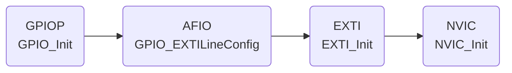

## 回顾中断

中断是现代芯片非常重要的一个特性，如果读者学习过操作系统，操作系统的进程调度，最最底层就是依靠芯片自己的中断来完成的。

中断允许芯片暂停当前的主程序（`main.c` 中的 main 函数），然后去做别的事情。比如我们使用的键盘在敲字的时候，就会触发中断，然后 CPU 会来处理用户刚刚按下的按键。从而实现敲击键盘打字的事情。

:::info

为什么不把键盘响应的事件写在主函数的 `while` 循环中呢？因为这么做效率非常低，每一个循环都要去检查键盘有没有按键被按下，如果外设更多，效率就更低了。为了让 CPU 能够去“响应”外部的事件，CPU 设计的时候需要实现中断。更加具体的知识，可以去学习计算机组成原理这门课。

:::

因为处理事务的复杂性，一般的 CPU 会提供不止一种的中断通道，比如 stm32 的比较高端的型号一共提供了 68 个中断通道，比如 EXTI、TIM、ADC、USART、SPI、I2C、RTC等多个外设。如果一个时钟周期内，多个中断被触发了，NVIC（nested vector interupt controller，嵌套向量中断控制器）会负责控制这些中断的优先级（当然，每一个中断的优先级是嵌入式工程师定义的，也就是我们）。

<div align=center>

</div>


每一个中断通道都会在对应中断发生时去调用用户编写的中断函数（如果有的话）。这些中断通道本质上存储了用户编写的C程序的对应中断函数的内存地址。keil5 的内置编译器（或者其他第三方编译器比如arm-gcc）会自动将不同的中断函数映射到用户编写的中断函数的内存地址上。从而完成用户中断函数的注册。

本文主要讲解基于边沿检测的中断 EXTI（External interrupt/event controller），它可以根据输入引脚发生上升沿或者下降沿来触发中断。对于很多的传感器和外部输入，它们本质就是方波。基于 EXTI，就可以做到处理这些输入的中断。

---

## EXTI 基本结构

从 GPIO 到 EXTI 的内部线路如下

<div align=center>

</div>


可以看到 GPIO 先要经过 AFIO，AFIO 用于进行线路选择，它输出 16 个信号，用户可以通过配置 AFIO 来选择哪个 GPIO 的哪条线会搭到 AFIO 输出的线路里。比如可以选择将 PB10 输出到 AFIO 的第 10 号输出上。有一个需要注意的是，AFIO 的输出编号和输出编号必须相同，这意味着你只能将 GPIOx 输出到 x 号输出上。因为 x 号输出只有一条线，所以对于特定的一个编号，比如 13 号，PA13，PB13，PC13 你只能选择其中的一个输出到 AFIO 的 13 号输出上。

EXTI 模块内则是根据用户配置触发线路和触发方式（上升沿还是下降沿），如果发生了中断，EXTI 则会根据之前配置好的线路将对应的中断向量表内的函数和优先级等信息传递给 NVIC 模块，NVIC 再进行配置。

因此，整个中断的配置过程需要配置四个地方：

<center>




</center>


---

## 例子：旋钮编码器

这里采用旋钮编码器来测试中断模块，接线图如下：

<div align=center>

</div>


:::info

有关旋转编码器内部原理的，可以去看 https://www.bilibili.com/video/BV1th411z7sn?p=11

:::


代码和注释如下：

```c
// Encoder.h

#ifndef __ENCODER_H
#define __ENCODER_H

void Encoder_Init();
int16_t Encoder_Count_Get();

#endif
```

```c
// Encoder.c

#include "stm32f10x.h"

void Encoder_Init() {
    // 配置 GPIOB
    RCC_APB2PeriphClockCmd(RCC_APB2Periph_GPIOB, ENABLE);
    GPIO_InitTypeDef GPIO_InitStructure;
    GPIO_InitStructure.GPIO_Mode = GPIO_Mode_IPU;
    GPIO_InitStructure.GPIO_Pin = GPIO_Pin_0 | GPIO_Pin_1;
    GPIO_InitStructure.GPIO_Speed = GPIO_Speed_50MHz;
    GPIO_Init(GPIOB, &GPIO_InitStructure);

    // 配置 AFIO
    RCC_APB2PeriphClockCmd(RCC_APB2Periph_AFIO, ENABLE);
    GPIO_EXTILineConfig(GPIO_PortSourceGPIOB, GPIO_PinSource0);
    GPIO_EXTILineConfig(GPIO_PortSourceGPIOB, GPIO_PinSource1);

    // 配置 EXTI，下降沿触发，中断模式，使能到 NVIC 的 14 号引脚 
    EXTI_InitTypeDef EXTI_InitStructure;
    EXTI_InitStructure.EXTI_Line = EXTI_Line0 | EXTI_Line1;
    EXTI_InitStructure.EXTI_LineCmd = ENABLE;
    EXTI_InitStructure.EXTI_Mode = EXTI_Mode_Interrupt;
    EXTI_InitStructure.EXTI_Trigger = EXTI_Trigger_Falling;
    EXTI_Init(&EXTI_InitStructure);

    // 配置 NVIC，抢占优先级和响应优先级都设置为 1
    // 此处是为旋钮进行配置，所以配置左右两个
    NVIC_PriorityGroupConfig(NVIC_PriorityGroup_2);
    NVIC_InitTypeDef NVIC_InitStructure;
    NVIC_InitStructure.NVIC_IRQChannel = EXTI0_IRQn;
    NVIC_InitStructure.NVIC_IRQChannelCmd = ENABLE;
    NVIC_InitStructure.NVIC_IRQChannelPreemptionPriority = 1;
    NVIC_InitStructure.NVIC_IRQChannelSubPriority = 1;
    NVIC_Init(&NVIC_InitStructure);

    NVIC_PriorityGroupConfig(NVIC_PriorityGroup_2);
    NVIC_InitStructure.NVIC_IRQChannel = EXTI1_IRQn;
    NVIC_InitStructure.NVIC_IRQChannelCmd = ENABLE;
    NVIC_InitStructure.NVIC_IRQChannelPreemptionPriority = 1;
    NVIC_InitStructure.NVIC_IRQChannelSubPriority = 2;
    NVIC_Init(&NVIC_InitStructure);
}

int16_t Encoder_Count = 0;

void EXTI0_IRQHandler() {
    // if 可以没有，但是为了规范，建议写一下
    if (EXTI_GetITStatus(EXTI_Line0) == SET) {
        // 当 PB0 输入下降沿触发中断后，判断 PB1 的值，如果是 0，说明是正转（因为旋转编码的的两个转口是正交的）
        // 详细请看：https://www.bilibili.com/video/BV1th411z7sn/?p=12&share_source=copy_web&vd_source=5c7883370b8ac639e64c6b403ee2f3aa
        if (GPIO_ReadInputDataBit(GPIOB, GPIO_Pin_1) == 0) {
            Encoder_Count --;
        }
        // 别忘了清除中断标志位
        EXTI_ClearITPendingBit(EXTI_Line0);
    }
}

void EXTI1_IRQHandler() {
    // if 可以没有，但是为了规范，建议写一下
    if (EXTI_GetITStatus(EXTI_Line1) == SET) {
        if (GPIO_ReadInputDataBit(GPIOB, GPIO_Pin_0) == 0) {
            Encoder_Count ++;
        }
        // 别忘了清除中断标志位
        EXTI_ClearITPendingBit(EXTI_Line1);
    }
}

int16_t Encoder_Count_Get() {
    int16_t temp;
    temp = Encoder_Count;
    // 减少代码耦合度，让中断函数的返回结果不依赖之前的中断
    Encoder_Count = 0;
    return temp;
}
```


主函数如下：

```c
#include "stm32f10x.h"
#include "Delay.h"
#include "OLED.h"
#include "Encoder.h"

int16_t num = 0;

int main(void) {
    OLED_Init();
    Encoder_Init();

    OLED_ShowString(1, 1, "Num:");

    while (1) {
        num += Encoder_Count_Get();
        OLED_ShowSignedNum(1, 5, num, 5);
    }
}

```

效果如下，当向右旋转旋钮时，屏幕上计数器会不断增加，反之会不断减少。

<div align=center>

</div>