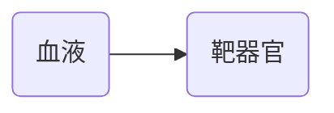

## ADME

药物代谢动力学研究的内容主要包括：

- 药物吸收（Absorption）：转运
- 药物分布（Distribution）：转运
- 药物代谢（Metabolism）：转化
- 药物排泄（Excretion）：转运

这个过程称为 ADME，更加详细的说明如下

- A：Absorption ：药物从作用部位进入 体循环的过程（转运）
- D：Distribution ：药物吸收后通过细胞 膜屏障向各组织、器官或者体液进行转 运的过程（转运）
- M：Metabolism（Biotransformation）： 药物在体内受酶系统或者肠道菌丛的作 用而发生结构转化的过程（转化）
- E ：Excretion：药物以原型或者代谢产 物的形式排出体外的过程（转运）

用药后随时间的推移，药物在体内的量 尤其是在血浆中的浓度会发生改变----时 量（浓）关系，研究时间浓度的变化就 是药动学的内容，主要用数学公式、图 表来解释。

这个很重要，有的药物使用量过低，在体内就没有任何作用，有的药物使用量过高，就会产生毒性。

## 药物的跨膜转运

### 概念

- 跨膜转运是药物分子通过细胞膜的现象
- 药物的体内转运要通过各种单层（如小肠 上皮细胞）或多层（如皮肤）细胞膜
- 细胞膜是药物体内转运的基本屏障

### 解离型和非解离型

药物中的成分分为非解离型和解离型

- 非解离型---脂溶性---易通过生物膜，比如 $\text B+\text H^+\leftrightarrow \text {BH}^+$

- 解离型---非脂溶性---难通过生物膜，比如 $\text{HA} \leftrightarrow \text H^+ + \text A^-$

药物的扩散速度取决于非解离型与解离型的浓度比。

非解离型药物的多少，取决于药物的解离度（Ka）和体液的pH。

## 影响药物转运的因素

因素为 **pH与pKa的变化**，会导致解离与不解离药物浓度差的指数级变化，所以pH 值的微小变动将显著影响药物的解离和转运。

> 抗高血压药美卡拉明为弱碱性，在酸性尿液中的清除速率为碱性尿液的 80 倍。

pH值越高，酸性药物的解离程度**越高**。（溶液中氢氧根变多了，酸性物质的$\text H^+$更容易中和）。同理，pH值越高，碱性药物的解离程度**越低**。

:::info
弱酸性药物中毒（巴比妥类），可碱化尿液来排泻药物。
:::

## 药物的体内过程

记住：ADME

---

## 吸收

吸收：从给药部位进入血液循环的过程

- 吸收的速度——药物起效的快慢

- 吸收的程度——药物起作用的程度

:::info
Q：静脉注射是否存在吸收的问题？

A：没有
:::

---

## 给药途径

1. 口服（胃肠道）给药
2. 注射给药
3. 呼吸道吸入给药（新冠喷雾剂）
4. 局部用药（外敷贴）
5. 舌下给药（速效救心丸）

### 口服给药

口服给药很方便。主要通过肠胃吸收，基本路径为：

大部分药物都会在肠道中被吸收，从而进入血液系统，这是因为肠道的面积更大，血管丰富，血流量大，所以大部分口服型药物通过肠道中的毛细血管进入血液循环中。

:::info
含钙、镁、铁类金属离子的中药不能联用四环素。

含钙、镁、铁等金属离子的药物，可 与四环素片形成不溶性络合物，使四 环素片吸收减少。
:::

大部分的药物都会因为肝脏的酶失活，因此口服药物的吸收过程存在 首过效应 first-pass elimination.

首过效应指：药物进入肝脏时被其中的酶所代谢、 灭活，再进入血液循环，此时血药浓 度下降。

> 首过效应是口服型药物设计和研发过程中的一大干扰因素。

### 舌下给药

舌下含服，就是将药品放在舌下含化， 因为舌下有丰富的血管，这种服药方法能让药物快速通过血管壁吸收。

避免首过消除, 不会被肝脏代谢损耗，吸收完全，直接起效

:::info 心绞痛
心绞痛是冠心病的常见症状，是由心肌急剧的、暂时性缺血和缺氧引起的。

舌下含服硝酸甘油，非解离型，脂溶性高，因此吸收快起效快。避免胃肠道给药的“首过效应”。
:::

### 注射给药

注射给药，字面意思，但是一共分为如下几种：

- 皮下注射（sc,subcutaneous）、肌肉注射（intramuscular,im）：注射局部血管，可应用较大剂量 病情较严重者——庆大
- 静脉注射（intravenous,iv）：直接入血，起效迅速 用于：急诊、休克病人
- 腹腔注射（腹膜内注射） （intraperitoneal,ip）：起效快，但常用于实验动物，糖尿病患者的胰岛素也是使用这个
- 动脉注射（intraarterial,ia）：危险性大，较少使用

:::info
Q: 急重症为什么用静脉注射？

A: 因为见效快
:::

### 吸入给药

吸入给药使用的是小分子脂溶性、挥发性的药物，通过呼吸系统进入肺泡，再通过肺泡庞大的表面积进入血液系统。

吸入给药实例：

- 以前临床麻醉：乙醚
- 心绞痛：亚硝酸异戊酯吸入

### 局部给药

在皮肤、眼、鼻、咽喉和阴道等部位产生局部作用

比如：

- 皮肤药
- 眼药水
- 硝酸甘油缓释贴皮剂

优点：

- 药物局部浓度高，副作用小
- 血浆药物有效浓度持续时间长

缺点当然是药效慢，效果差了。

### 吸收速率快慢

速率比较：静脉注射 > 吸入 > 舌下 > 直肠 > 肌肉 > 皮下注射 > 口服 > 皮肤

### 生物利用度

生物利用度、生物可用度 （Bioavailability，F），指 **机体吸收进入血液循环的药量与 给药剂量的比值**。

比如 静脉注射F值为100%

:::info 与厂家、剂型、批号关系很大
生物利用度与厂家生产药物的批次，辅料，等诸多原因相关，正因如此，药物生成是一项缜密的工程项目。

1968年澳大利亚生产的苯妥英钠片剂，病人服用疗 效一致很好。后来，将处方中的辅料 $\text{CaSO}_4$ 改为乳糖，其他未变，结果临床应用时连续发生中毒事件。 经研究发现，将处方中的 $\text{CaSO}_4$ 改为乳糖以后，压 制的片剂体外释放和体内吸收都大大提高，使血药 浓度超过了最低中毒浓度。
:::

---

## 分布

分布，指指药物吸收后从血液循环到达机体各个器管和组织（细胞间液和细胞内液）的过程。

- 药物分布越快，起效就越迅速
- 取决于组织器官血液量和药物与血浆蛋白、 组织细胞的结合能力
- 还取决于药物载体转运蛋白的数量、功能、 体液pH、生理屏障、药物本身的性质、制剂

### 药物与血浆蛋白的结合

药物主要会和血浆中的白蛋白（Albumin）结合，能与白蛋白。结合型和游离型处于动态平衡中。

结合型药物暂时失去药理活性，不被代谢， 成为药物在体内的储存库，所以作用持续时间长。

- 血浆中药物总量 = 结合型药物 + 游离型药物
- 药物的血浆蛋白结合率 = 结合型药物 / 血浆中药物总量

游离型与结合型药物的区别如下：

:::info 以下场景如何调控给药量
A、体内血浆蛋白降低的病理状态

药物剂量下调

B、当两种药物与血浆蛋白结合率都高

药物剂量下调

C、当药物与血浆蛋白结合达到饱和时

不能随便超剂量用药
:::

---

## 体内屏障

体内屏障一共三种：

1. 血脑屏障
2. 胎盘屏障
3. 血眼屏障

### 血脑屏障（BBB）

定义：血-脑之间一种选择性地 阻止各种物质由血入脑的屏障。

意义：保证大脑的安全

药物能否通过血脑屏障？

- 根据药物的分子量和脂溶性：分子量小，脂溶性大——易通过
- 药物与血浆蛋白结合率的高低：结合率低——易通过

:::info 常见物质通过血脑屏障的快慢
- 某些大分子、水溶性或解离型药物难 于进入脑组织；
- 有机酸或碱性药物进入脑组织缓慢；
- 而乙醚、硫喷妥等脂溶性很高的药物， 则能迅速向脑内转运，血液中浓度与 脑内浓度几乎瞬间达到平衡，这些药 物向脑内的转运仅与进入脑内的血流 量有关。
:::

### 胎盘屏障（Placental barriers ）

胎盘屏障的屏障效应相比BBB更低（能通过更多物质），这是因为母体需要向婴儿输送营养和药物抗体。

也正因如此，怀孕期间，孕妇用药慎重。脂溶性高易通过胎盘屏障，如全麻药、 巴比妥类、吗啡。

---

## 代谢

定义：药物吸收后在体内经酶或其他作用发生 的一系列化学反应，导致药物化学结构变化， 也称作生物转化（Biotransformation）

主要场所：肝脏

结果：使药物的活性发生改变（比如肝可以把非那西丁代谢为对乙酰氨基酚）

也因此，有一部分药物，这些药本身没有活性，经过身体代谢后有活性，被我们称为 **前药（prodrug）**

代谢会改变药物的活性，使得药物灭活失活：

- 活性降低或完全消失
- 使极性增加易于排出

### 肝药酶

在代谢过程中，肝药酶起着至关重要的作用。

- **促进药物代谢**：肝药酶能够催化许多结构不同的药物进行氧化过程，这是药物在肝脏中进行生物转化的关键步骤。其中，细胞色素P450单氧化酶系是肝药酶中最为重要的组成部分，它参与内源性物质和包括药物、环境化合物在内的外源性物质的代谢。
- **影响药物的药理作用**：许多药物或其他化合物可以改变肝药酶的活性。能提高酶活性的药物被称为“药酶诱导剂”，如苯巴比妥、苯妥英、利福平等，它们通过促进药物的代谢来降低大多数药物的药理作用，包括诱导剂本身和一些同时应用的药物。相反，一些药物如西咪替丁、酮康唑、氯霉素、异烟肼等，能抑制肝药酶的活性，使其他药物代谢减慢，导致药理活性及毒副作用增加。
- **帮助身体新陈代谢**：除了直接参与药物代谢外，肝药酶还在身体的新陈代谢过程中发挥着重要作用。它可以帮助身体分解和排除体内的有害物质，维护身体的正常生理功能。

### 肝脏功能决定药物代谢

用药时，肝脏功能决定药物的灭活与激化，密切注意患者肝功能。

---

## 排泄

药物的原形或代谢产物排出体外的过程。

### 排泄途径：肾排泄

肾脏：非挥发性药物的主要排泄途径。（此处应该重新回顾肾的全过程，也就是血管->肾小球过滤->肾小管分泌+重吸收）

加快排泄：减少重吸收，如弱酸性药物（如巴比妥），通过碱化尿液（如碳酸氢钠静脉点滴）加速排泄。

### 排泄途径：胆汁排泄

从图中可以看出，胆汁排泄与肝肠循环有关。

某些药中毒的解救——减少肝肠循环—— 泻下；强心苷中毒，口服考来烯胺形成络合物， 中断强心苷的肝肠循环，加快粪便排泄。

### 排泄途径：其他途径排泄

乳腺排泄、其他如汗液、泪液、唾液排泄